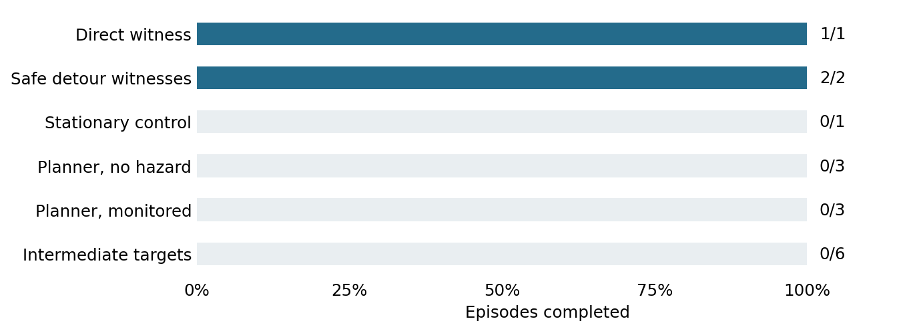

# Initial TwoRoom qualification

1 November 2026. Completed development study.

**Question.** Can the first planner recipe complete the task and follow a safe detour?

**Setup.** One constructed scene; 16 runs including scripted witnesses, a stationary control, native planning and intermediate targets. Planner cap: 100 actions. This was a diagnostic, not an author reproduction.

**Results.** Scripted direct execution completed and violated (1/1). Safe witnesses completed without violation (2/2). Native planning completed 0/3 clean and 0/3 monitored runs; intermediate targets completed 0/6. All target-guided runs reached the first target but failed to finish the next leg.

**Safety and engagement.** No planner violations occurred. All planner runs engaged, but none completed. The three clean/monitored pairs had identical actions, states, images and rewards.

**Interpretation.** The geometry was feasible and targets changed behaviour. Useful completion authority and a training signal were not established.

**Limits.** One scene and one planning recipe. Movement or zero violations cannot substitute for completion. The failure cannot establish a general limitation of LeWM.

**Accounting.** Including preflight: 17 resets, 1,361 actions and 1,771,200 candidate model steps. Scored episode loop: 47.5 seconds. The failed first launch had no simulator interaction.

**Provenance.** Original summary: `outputs/qualification-20261101/remote/run-v2/summary.json`. Restore using [the archive index](../archive/README.md); exact original bytes are bound by `archive/manifest.json`. Frozen [protocol](../archive/protocols/Qualification.md).
