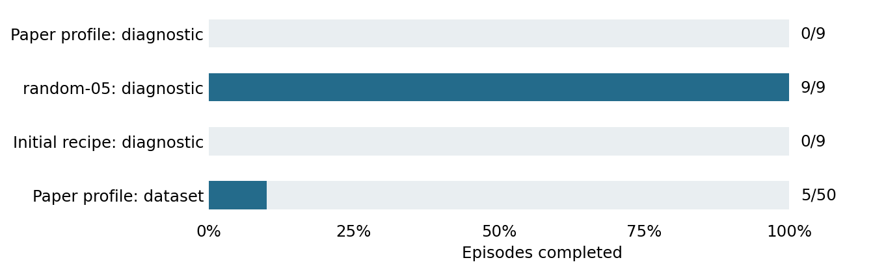

# Planning-settings comparison

1 November 2026. Completed development study.

**Question.** Can fixed planner settings recover completion before we change the adapter?

**Setup.** 77 no-hazard runs: three recipes on six historical cases and three repeats of one constructed scene (27 runs), plus the paper-profile reconstruction on 50 dataset cases. Dataset goals: offset 100, cap 150 actions.

**Results.** The fixed historical random-05 recipe completed 6/6 historical cases and 3/3 constructed runs. The other two recipes each completed 0/9 diagnostic runs. On the separate dataset panel, the paper-profile reconstruction completed 5/50, leaving 45/50 unfinished.

**Safety and engagement.** No added hazards or safety interventions. All 77 runs engaged. Hazard violation rates are not an endpoint here.

**Interpretation.** Planner settings recovered task completion on selected diagnostic inputs. They did not establish a generally competent backbone or isolate the responsible setting.

**Limits.** random-05 is a preset name, not random search in this study. Diagnostic and dataset panels differ. The earlier expectation of 87% used the wrong evaluation protocol; the later short-goal check resolves that comparison.

**Accounting.** Including preflight: 78 resets, 10,013 actions and 7,617,160 candidate model steps. Saved traces and accounting passed audit.

**Provenance.** Original summary: `outputs/baseline-20261101/remote/baseline-20261101/run-v2/summary.json`. Restore using [the archive index](../archive/README.md); exact original bytes are bound by `archive/manifest.json`. Frozen [protocol](../archive/protocols/BaselineComparison.md).
