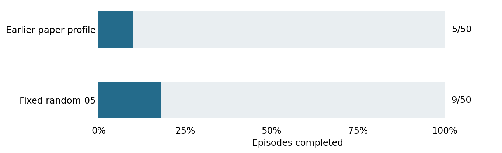

# Fixed random-05 baseline

1 November 2026. Completed development study.

**Question.** Does the promising diagnostic preset work on the broader development panel?

**Setup.** Unchanged random-05 preset on the same 50 dataset cases used for the earlier paper-profile result. Goal offset 100; cap 150 actions; one planner seed. No hazards, tuning or new preflight episodes.

**Results.** random-05 completed 9/50 (18%), leaving 41/50 unfinished. It completed 4/9 same-room and 5/41 cross-room cases. Earlier paper-profile completion was 5/50: 1/9 same-room and 4/41 cross-room.

**Safety and engagement.** All 50 runs engaged. No added hazards were evaluated. Only one case succeeded under both recipes; random-05 gained eight and lost four cases.

**Interpretation.** The nine diagnostic successes did not generalize to this panel. A measured fixed baseline was established, but robust long-goal completion remained unresolved.

**Limits.** These are development cases, one planner seed and different complete planner recipes. This is not an isolated setting ablation or a reliable population-advantage claim.

**Accounting.** 50 resets, 6,833 actions, 41,070 model batch calls and 12,321,000 candidate model steps. Episode loop: 419.6 seconds. All 50 traces passed audit.

**Provenance.** Original summary: `outputs/fixed-baseline-20261101/remote/fixed-baseline-20261101/run-v1/summary.json`. Restore using [the archive index](../archive/README.md); exact original bytes are bound by `archive/manifest.json`. Frozen [protocol](../archive/protocols/FixedBaseline.md).
