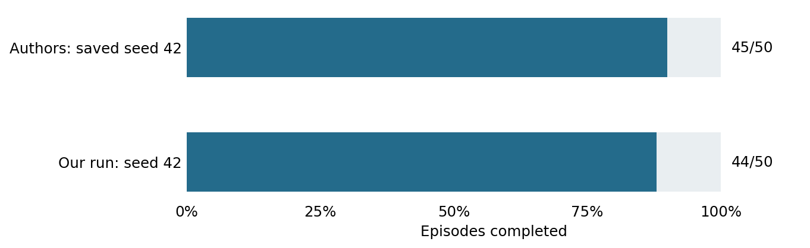

# Short-goal evaluator replication

1 November 2026. Completed development study.

**Question.** Can we recover the reported high completion under the released short-goal protocol?

**Setup.** Unmodified released evaluator, seed 42 and 50 source queries. Effective goal offset 24; cap 50 actions. CEM: 300 candidates, 30 iterations, 30 elites, five five-action blocks, execute 25 actions.

**Results.** Our run completed 44/50 (88%), leaving six unfinished. The authors' saved seed-42 record used exactly the same 50 source rows and completed 45/50. Episode outcomes agreed on 47/50.

**Safety and engagement.** No hazard diagnostic was included. Independent auditing recovered every recorded completion from native state traces.

**Interpretation.** The large earlier discrepancy was primarily a protocol-comparison problem: short-goal and long-goal results answer different questions. This run largely resolves the short-goal baseline concern.

**Limits.** One seed on a disclosed runtime, not exact per-episode replication or the published three-seed 87.3% mean. stable-worldmodel 0.0.6 was isolated; existing Torch and Transformers versions were retained. An import shim exposes the installed ImageNet constants without modifying the evaluator.

**Accounting.** Scored run: 50 resets, 2,500 actions, 3,000 model batch calls, 4,500,000 predicted blocks and 6,000 encoder frames; 651.3 seconds. Separate AP preflight: one reset, one action, two cost calls, 16 blocks and four encoder frames.

**Provenance.** Original summary: `outputs/anchored-20261101/remote/anchored-20261101/short-v1/run.json`. Restore using [the archive index](../archive/README.md); exact original bytes are bound by `archive/manifest.json`. Frozen [protocol](../archive/protocols/AnchoredQualification.md).
