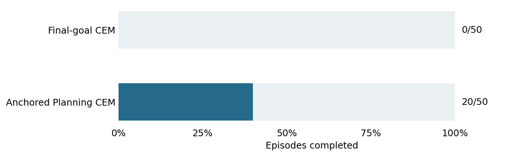

# Matched long-goal AP comparison

1 November 2026. Completed development study.

**Question.** Does choosing a nearby observation target improve frozen-planner completion?

**Setup.** 50 paired development cases, goal offset 100 and cap 200 actions. Both arms use identical one-block CEM: 300 candidates, 30 iterations, 30 elites, five-action execution and paired seeds. Only the target changes.

**Results.** Final-goal CEM completed 0/50; AP-CEM completed 20/50 (40%). AP completed 8/9 same-room and 12/41 cross-room cases. All 100 runs engaged; 50 final-goal and 30 AP runs remained unfinished.

**Safety and engagement.** No hazards. Observation-only memory used 8,000 episodes, excluding all short- and long-goal evaluation source episodes. Recorded actions were not used for retrieval or CEM initialization. Every retrieved source and successor passed the exclusion and boundary audit.

**Interpretation.** Target selection is a useful fixed planning lever on this panel. The predeclared 20/50 completion threshold and ten-case advantage were met, permitting the bounded hazard diagnostic.

**Limits.** AP is an existing method and a baseline, not our evolutionary contribution. The panel is development evidence, not held-out evaluation or the paper's exact panel. Prior random-05 used different CEM settings and a 150-action cap.

**Accounting.** 100 resets, 17,662 actions, 109,709 model batch calls, 31,858,078 predicted blocks and 6,273 encoder frames. Cache construction separately encoded 920,809 frames in 431.8 seconds.

**Provenance.** Original summary: `outputs/anchored-20261101/remote/anchored-20261101/long-v1/summary.json`. Restore using [the archive index](../archive/README.md); exact original bytes are bound by `archive/manifest.json`. Frozen [protocol](../archive/protocols/AnchoredQualification.md).
