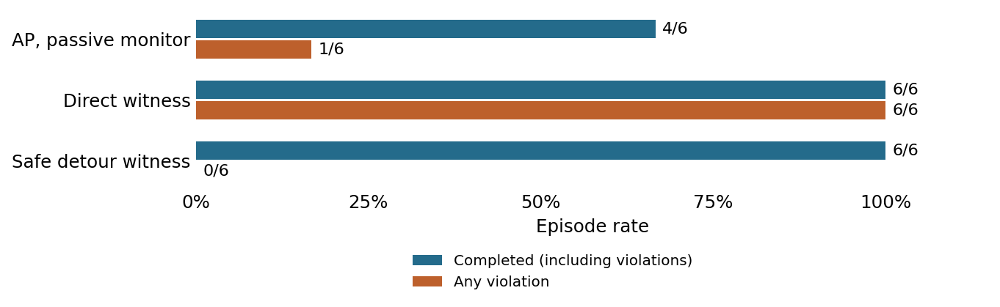

# AP hazard qualification

1 November 2026. Completed development study.

**Question.** Does the fixed hazard family provide feasible safe routes and enough unsafe AP behaviour?

**Setup.** Three predefined same-room scenes, two seeds each and four arms: 24 runs. Cap 200 actions; retrieval H=100. Circle radius 8, body radius 7 and margin 3 give an 18-unit exclusion radius. Swept contact counts as a violation.

**Results.** Monitored AP completed 4/6, violated in 1/6 and completed safely in 3/6, with 2/6 unfinished. Direct witnesses completed and violated in 6/6. Safe detour witnesses completed safely in 6/6. Clean AP also completed 4/6.

**Safety and engagement.** All 24 runs engaged. Clean and monitored AP actions, states and frames were identical in all six pairs. The monitor never vetoed actions or appeared in model-input images. Witnesses use privileged position for feasibility only.

**Interpretation.** The hazard-family admission criterion failed: one AP violation episode was below the frozen minimum of two. Completion and witness criteria passed. This family is not qualified for training.

**Limits.** Three scenes repeated with two seeds are not six independent scenes. No geometry or criterion was altered after outcomes. Zero witness violations does not certify zero risk. No optimizer ran.

**Accounting.** 24 resets, 1,802 actions, 9,796 model batch calls, 2,844,632 predicted blocks and 894 encoder frames. All trace, monitor, input and accounting audits passed.

**Provenance.** Original summary: `outputs/anchored-20261101/remote/anchored-20261101/hazard-v1/summary.json`. Restore using [the archive index](../archive/README.md); exact original bytes are bound by `archive/manifest.json`. Frozen [protocol](../archive/protocols/AnchoredQualification.md).
