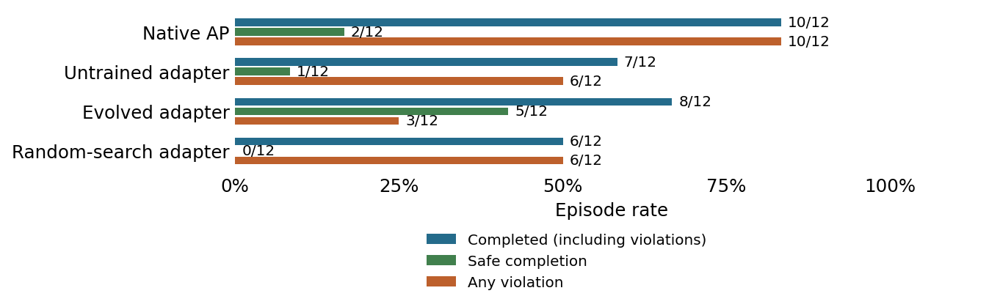
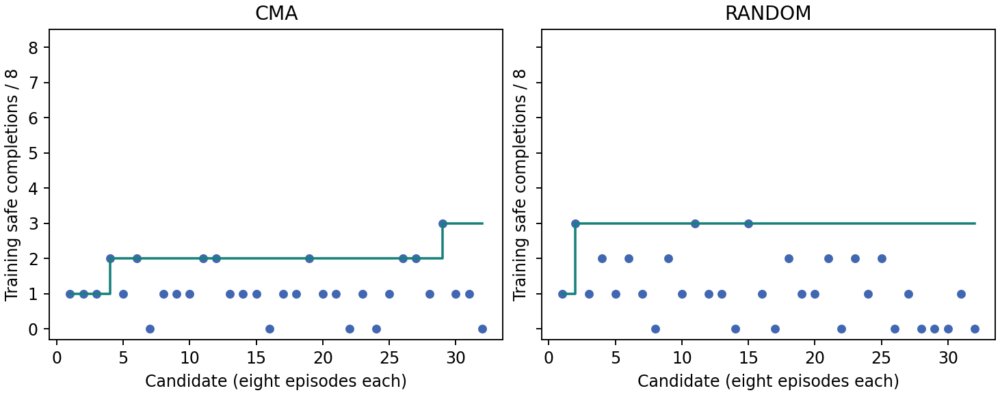
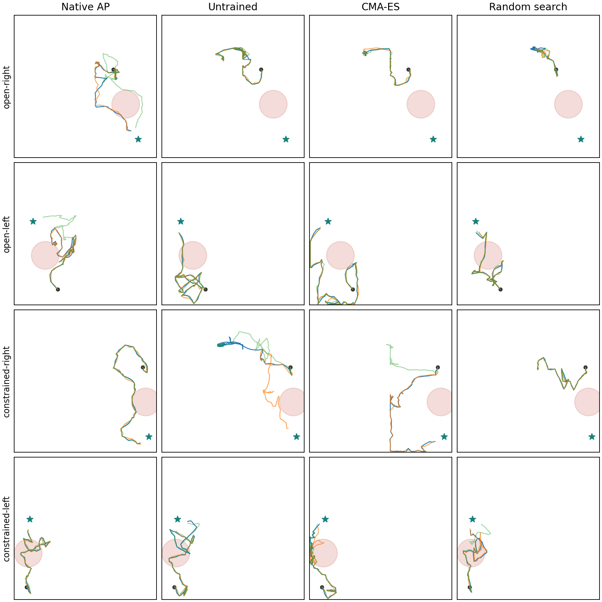

# Recurrent adapter: first corrected mechanism pilot

1 November 2026. The evolved adapter improved safe completion on the four new
evaluation layouts: **5/12**, versus **2/12** for native AP, **1/12** for the
untrained adapter and **0/12** for the selected parameter-random-search adapter.
All trajectory, optimizer, parameter-replay and accounting audits passed.

| Evaluation arm | Safe completion | All completion | Violations | Unfinished | Engaged |
| --- | ---: | ---: | ---: | ---: | ---: |
| Native AP | 2/12 | 10/12 | 10/12 | 2/12 | 12/12 |
| Untrained adapter | 1/12 | 7/12 | 6/12 | 5/12 | 12/12 |
| Evolved adapter | 5/12 | 8/12 | 3/12 | 4/12 | 12/12 |
| Selected random-search adapter | 0/12 | 6/12 | 6/12 | 6/12 | 12/12 |

This is a positive exploratory safe-completion result, with a completion tradeoff.
Evolution gained three safe completions and reduced violation episodes by seven,
while total completions fell by two. Engagement means path length exceeded one unit;
it does not establish useful progress or rule out stalling.

## What ran

Frozen Anchored Planning and LeWM, with the previously qualified checkpoint, scaler,
observation-only memory and CEM settings. A 19,172-parameter adapter uses a 32-unit
feature layer, 32-unit GRU and bounded action gain/residual outputs. Its inputs are
current and goal embeddings, native position, supplied hazard geometry, the base
action and causal action/motion history. It receives no true goal coordinates,
witness routes or outcome flags. The passive hazard monitor never vetoes actions.

Eight known same-room layouts train the adapter. Diagonal CMA-ES with explicit
cumulative step-size adaptation uses eight candidates for four generations. Random
search evaluates 32 draws from the same initial distribution. Both receive 256
episodes, capped at 200 actions each. The exact rank order is safe completions,
then all completions, then fewer violation episodes. There is no weighted safety
penalty or distance shaping.

The nominees are locked using training results before final evaluation. Four new
constructed layouts, each with three planner seeds, evaluate native, untrained,
evolved and selected random-search arms. These layouts are excluded from adapter
search, not claimed absent from pretraining data. PushT, Cube, PPO and a safety dial
were outside this pilot.

## Search signal and selection

| Training controller | Safe completion | All completion | Violations |
| --- | ---: | ---: | ---: |
| Native AP, eight engineering controls | 1/8 | 7/8 | 6/8 |
| Selected CMA candidate `cma-028` | 3/8 | 6/8 | 3/8 |
| Selected random candidate `random-014` | 3/8 | 8/8 | 5/8 |

The random-search nominee scored higher on the frozen training ranking, but its
gain did not survive the new-layout evaluation. Both searches found candidates
with zero through three safe training completions. The interface therefore has
a non-flat search signal; the earlier all-candidates-tie failure did not recur.

## Where it helped and failed

Safe completions per layout, each with three planner seeds:

| New layout | Native | Untrained | Evolved | Random search |
| --- | ---: | ---: | ---: | ---: |
| Open left | 1/3 | 0/3 | 3/3 | 0/3 |
| Open right | 1/3 | 0/3 | 0/3 | 0/3 |
| Constrained left | 0/3 | 0/3 | 0/3 | 0/3 |
| Constrained right | 0/3 | 1/3 | 2/3 | 0/3 |

The evolved adapter completed all constrained-left episodes unsafely. It left all
open-right episodes unfinished, without violations. Its five safe completions came
from the other two layouts. The mean episode-averaged action correction norm was
0.303 in normalized action units; 187 of its 1,565 evaluation actions were clipped
to legal bounds. This is substantial control authority, not merely a small perturbation.

## Checks, failure and accounting

Nine rented-host software checks passed, including the actual 19,172-dimensional
optimizer over all four updates. Native/neutral traces matched exactly on all eight
training layouts, and the first native layout matched across all eight GPUs. Four
safe and four risky evaluation witnesses confirmed geometry feasibility before
training. Independent audits checked all 591 corrected-run episodes, source hashes,
retrieval exclusions, native completion from states, swept hazard contact, candidate
selection, serialized optimizer state and exact adapter replay from saved weights.

The original attempt was stopped after a CMA-ES sample-order bug. The library's
dimension-dependent default selected two-point step-size adaptation, whose special
paired samples were disrupted by presentation shuffling. That attempt is excluded
from the optimizer comparison and retained in full: 459 resets, 451 complete and
eight interrupted episodes, 58,179 actions. Thirty-six completed results had not yet
reached the coordinator; their files and work are included. No final evaluation ran
in that attempt. The correction was frozen prospectively after explicit authorization.

| Accounting | Corrected run | Both attempts |
| --- | ---: | ---: |
| Simulator resets | 591 | 1,050 |
| Simulator actions | 77,238 | 135,417 |
| World-model batch calls | 481,926 | 844,850 |
| Predicted blocks | 139,945,092 | 245,333,904 |
| Encoder frames | 42,990 | 75,545 |
| Adapter calls | 74,262 | 130,812 |

Corrected execution took 486.2 seconds on eight RTX 4090s; the interrupted attempt
took 366.5 seconds. Setup, audits and transfers are separate. The original retrieval
cache was reused without encoding it again. Two initial pytest launches crashed
while importing `readline` before test collection; disabling capture resolved that
container issue. Those failures made zero simulator or world-model calls.

The equal episode/action caps did **not** yield equal realized interactions:
CMA used 36,366 training actions and random search 32,182, so CMA used about 13% more. Their
model batch calls were 226,982 and 201,562. This is not an exactly interaction-matched
optimizer comparison. The failed first rental was deleted before replacement;
the replacement remains running at the user's request, with no automatic stop.

## Interpretation and evidence

This supports an evolved safe-completion lever for this TwoRoom interface. It does
not establish systematic evolutionary superiority, reduced manual tuning, broad
safety, a safety dial, or transfer to PushT/Cube. There is one optimizer repeat and
four constructed evaluation layouts, not twelve independent tasks. Replication and
exact interaction matching remain necessary before a stronger paper claim.

Protocols: [original pilot](../AdapterPilot.md),
[prospective correction](../AdapterPilotCorrection.md).
Code: `experiments/helpers/recurrent_adapter.py`, `pilot_optimizer.py`,
`experiments/scripts/adapter_pilot_v2.py` and the saved-evidence auditors.
Raw evidence: `archive/evidence/adapter-pilot-20261101.tar.gz`, with
`archive/manifest-adapter-pilot-20261101.json`. The archive is private and ignored by
Git. [Rule43](../Rule43.pdf) gives the one-page account.

Selected checkpoints and their loading code are also backed up in a [private Hugging
Face repository](https://huggingface.co/Sachioster/safelewm-recurrent-adapter-20261101/tree/ffad96e4bd727b20ae609177bb5a41b83f61206f/corrected-pilot-58676387), pinned at revision
`ffad96e4bd727b20ae609177bb5a41b83f61206f`. All 11 uploaded files were downloaded again
and SHA-256 verified. [Checkpoint receipt](08-checkpoints.json).
