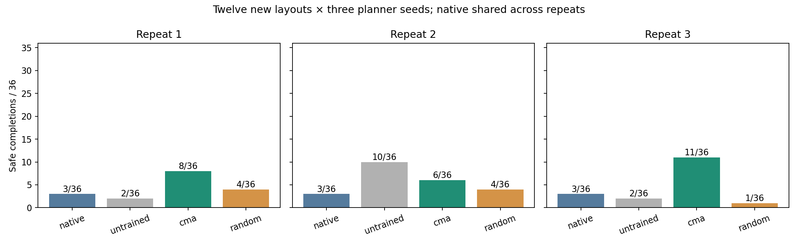
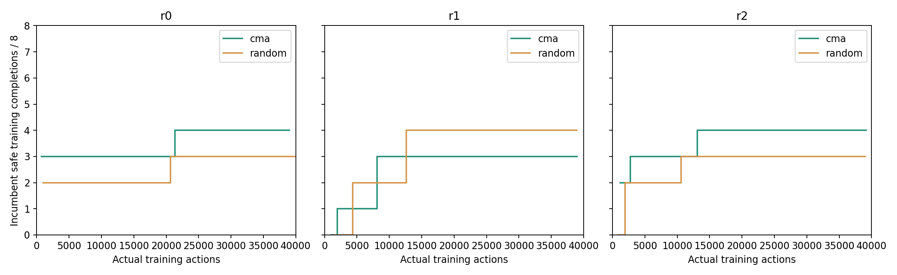

# TwoRoom adapter replication: three paired repeats

1 November 2026. All six searches, 360 final evaluation episodes and the saved-evidence
audit completed. Each search used exactly 40,000 simulator actions, for 240,000
training actions in total. The prior pilot remains separate development evidence.

CMA achieved 8/36, 6/36 and 11/36 safe completions, versus native 3/36 and
selected random search 4/36, 4/36 and 1/36. Gains appeared in all three repeats
on this panel. However, both exploratory uncertainty intervals include zero;
a broader advantage remains unestablished. The second untrained reference
outperformed its paired CMA run (10/36 versus 6/36).

## Evaluation outcomes

Twelve new layouts, each with three planner seeds. Native is evaluated once and
shared across comparisons. Each learned or untrained repeat has 36 episodes.

| Repeat | Controller | Safe completion | All completion | Violations | Unfinished | Engaged |
| --- | --- | ---: | ---: | ---: | ---: | ---: |
| Shared | Native AP (shared) | 3/36 | 21/36 | 21/36 | 15/36 | 36/36 |
| r0 | Untrained | 2/36 | 12/36 | 18/36 | 24/36 | 36/36 |
| r0 | CMA-ES | 8/36 | 20/36 | 20/36 | 16/36 | 36/36 |
| r0 | Random search | 4/36 | 25/36 | 21/36 | 11/36 | 36/36 |
| r1 | Untrained | 10/36 | 20/36 | 14/36 | 16/36 | 36/36 |
| r1 | CMA-ES | 6/36 | 15/36 | 15/36 | 21/36 | 36/36 |
| r1 | Random search | 4/36 | 23/36 | 25/36 | 13/36 | 36/36 |
| r2 | Untrained | 2/36 | 11/36 | 11/36 | 25/36 | 36/36 |
| r2 | CMA-ES | 11/36 | 22/36 | 17/36 | 14/36 | 36/36 |
| r2 | Random search | 1/36 | 12/36 | 13/36 | 24/36 | 36/36 |

## Safe completion by layout

Each entry is out of three planner seeds. Triplets list repeats 1, 2 and 3.

| Layout | Native | CMA | Random search | Untrained |
| --- | ---: | --- | --- | --- |
| rep-open-left-down-a | 0 | 3 / 0 / 1 | 0 / 0 / 0 | 0 / 0 / 0 |
| rep-open-right-up-a | 3 | 0 / 0 / 0 | 1 / 0 / 0 | 0 / 0 / 2 |
| rep-open-left-up-b | 0 | 0 / 0 / 0 | 0 / 2 / 0 | 0 / 1 / 0 |
| rep-open-right-down-b | 0 | 1 / 0 / 3 | 2 / 1 / 0 | 2 / 0 / 0 |
| rep-open-left-down-c | 0 | 1 / 0 / 3 | 0 / 1 / 0 | 0 / 0 / 0 |
| rep-open-right-up-c | 0 | 0 / 0 / 0 | 0 / 0 / 0 | 0 / 0 / 0 |
| rep-edge-left-down-a | 0 | 1 / 2 / 1 | 1 / 0 / 0 | 0 / 0 / 0 |
| rep-edge-right-up-a | 0 | 0 / 0 / 0 | 0 / 0 / 0 | 0 / 3 / 0 |
| rep-wall-left-up-b | 0 | 0 / 1 / 0 | 0 / 0 / 0 | 0 / 0 / 0 |
| rep-wall-right-down-b | 0 | 0 / 0 / 0 | 0 / 0 / 0 | 0 / 3 / 0 |
| rep-edge-left-up-c | 0 | 1 / 0 / 0 | 0 / 0 / 0 | 0 / 1 / 0 |
| rep-edge-right-down-c | 0 | 1 / 3 / 3 | 0 / 0 / 1 | 0 / 2 / 0 |

Native's three safe completions all came from `rep-open-right-up-a`; every CMA
repeat scored zero safe completions there. The learned gains therefore coexist
with loss of native competence on that layout.

Full per-layout completion, violation, unfinished and engagement counts are in
[the analysis record](09-analysis.json).

## Design and limits

The architecture, frozen AP assets, eight training layouts and training planner seed
are unchanged. Three fresh paired initialization/search seeds compare diagonal
CMA-ES with parameter random search. Both receive the same inputs and exact actual
action allowance. Candidate selection prioritizes safe completion, then completion,
then fewer violations. Complete panels are eligible; partial panels are retained
and excluded. All six nominees were locked before any final evaluation outcomes.

This is a same-room TwoRoom development study. It does not establish transfer to
PushT/Cube, reduced manual tuning, equivalence to an expert, a safety dial, or an
advantage over RL. No PPO or tuned fixed-adapter comparison ran. The twelve layouts
are reused across three training repeats; the 108 learned-policy episodes are not
108 independent tasks. New to adapter search does not mean absent from pretraining.

## Paired uncertainty

- CMA minus native: mean difference +14.8 percentage points; exploratory 95% interval [-12.0%, +39.8%].
- CMA minus random search: mean difference +14.8 percentage points; exploratory 95% interval [-3.7%, +36.1%].

Intervals above express percentage-point differences. Both include zero.
These are the prospectively specified 2,000 crossed bootstrap draws (seed 9501),
resampling training repeats and layouts while keeping each layout's planner seeds
and arm comparisons paired. Three training repeats provide limited uncertainty
information. Intervals are exploratory; no favorable run is selected for reporting.

## Training and accounting

| Search | Actions | Eligible candidates | Partial candidates | CMA updates |
| --- | ---: | ---: | ---: | ---: |
| r0-cma | 40,000 | 40 | 1 | 5 |
| r0-random | 40,000 | 39 | 1 | 0 |
| r1-random | 40,000 | 37 | 1 | 0 |
| r1-cma | 40,000 | 35 | 1 | 4 |
| r2-cma | 40,000 | 36 | 1 | 4 |
| r2-random | 40,000 | 39 | 1 | 0 |

The final incomplete generation is never passed to CMA tell. Fully evaluated
candidates in that generation remain eligible. Every sampled genotype, including
unexecuted members of the final population, is preserved. No allowance was padded.

| Resource | Count |
| --- | ---: |
| environment_resets | 2,254 |
| environment_actions | 294,707 |
| model_batch_calls | 1,839,013 |
| candidate_model_steps | 534,025,646 |
| encoder_frames | 163,836 |
| adapter_calls | 287,689 |

Execution took 2492.9 seconds on the existing eight RTX 4090s. Setup,
auditing, analysis and transfers are separate. The existing retrieval cache was
reused. All work, including budget-truncated episodes, is counted. The rental
remains running at the user's request; no automatic rental stop was installed.

## Verification and preservation

All 13 software checks passed on the rental before launch, including the actual
19,172-dimensional optimizer, the production budget scheduler and layout geometry.
Native/neutral parity passed on all eight training layouts, with cross-GPU checks
and one-/seven-action prefix checks. All twelve safe and twelve risky witnesses
completed with their intended monitor outcomes before training.

The saved-evidence audit passed for all 2,254 episodes and
43 source bindings, including 287,689
exact actor replay steps. It checked native completion from states, swept hazard
contact, retrieval exclusions, quota accounting, parameter decoding, optimizer
states, partial-panel exclusion and selection timing. Auditing added no simulator
or world-model interactions.

Protocol: [AdapterReplication.md](../AdapterReplication.md).
Raw evidence: `archive/evidence/replication-20261101.tar.gz`, indexed by
`archive/manifest-replication-20261101.json`. Local byte-verification and checkpoint
backup status are recorded separately in the preservation receipt.

All **13,944 archived files** passed independent local SHA-256 verification.
The [preservation receipt](09-preservation.json) records the archive hash and scope.
The still-open packaging logs were excluded from the main archive, then preserved
separately after closure. No original experiment evidence was deleted from the host.

The 25-file checkpoint bundle was uploaded to the explicitly approved private
Hugging Face destination and all files were downloaded again and hash-verified.
[Checkpoint backup](https://huggingface.co/Sachioster/safelewm-recurrent-adapter-20261101/tree/7a21f575442b58d25d943f54e808dad118d8e413/replication-58676387); [pinned revision and hashes](09-checkpoints.json).
