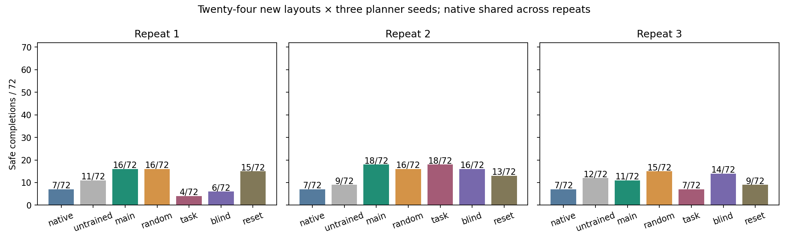

# TwoRoom representation and mechanism study

1 November 2026. All 24 searches, 1,368 final episodes and 144 paired-hazard diagnostic episodes completed. Each search used exactly 40,000 actual training actions. The revised saved-evidence audit passed; its original timestamp-check failure remains preserved.

**Finding:** the selected head-only CMA adapter improved safe completion over native AP in all three repeats, but did not outperform matched parameter random search overall. CMA safe completion was 16/72, 18/72 and 11/72; random search achieved 16/72, 16/72 and 15/72; shared native achieved 7/72.

## Representation selection

All actors retain 19,172 weights. Stage A optimized all weights, only the 132 head coordinates, or 256 projected coordinates, with three paired searches each. The previous replication panel became development data for this study. Full/head/subspace achieved 15/108, 27/108 and 18/108 safe development completions. Head-only was selected prospectively by the frozen rule. This is configuration selection, not independent proof that head-only is generally superior. Its 360,000 development training actions count toward the total.

## Final outcomes

Twenty-four new layouts, each with three planner seeds. Native is shared. Other rows pool three training repeats over the same layouts; they are not 216 independent tasks. Violations can overlap with completed or unfinished episodes.

| Controller | Safe completion | Completion | Violations | Unfinished | Engaged |
| --- | ---: | ---: | ---: | ---: | ---: |
| Native AP | 7/72 | 39/72 | 39/72 | 33/72 | 72/72 |
| Untrained | 32/216 | 130/216 | 114/216 | 86/216 | 216/216 |
| Safety-aware CMA | 45/216 | 115/216 | 94/216 | 101/216 | 216/216 |
| Random search | 47/216 | 134/216 | 95/216 | 82/216 | 216/216 |
| Task-only CMA | 29/216 | 123/216 | 120/216 | 93/216 | 216/216 |
| Hazard-blind CMA | 36/216 | 125/216 | 107/216 | 91/216 | 216/216 |
| Memory-reset CMA | 37/216 | 136/216 | 111/216 | 80/216 | 216/216 |



## Each training repeat

| Repeat | Controller | Safe completion | Completion | Violations | Unfinished | Engaged |
| --- | --- | ---: | ---: | ---: | ---: | ---: |
| B0 | Untrained | 11/72 | 52/72 | 44/72 | 20/72 | 72/72 |
| B0 | Safety-aware CMA | 16/72 | 36/72 | 29/72 | 36/72 | 72/72 |
| B0 | Random search | 16/72 | 50/72 | 37/72 | 22/72 | 72/72 |
| B0 | Task-only CMA | 4/72 | 33/72 | 34/72 | 39/72 | 72/72 |
| B0 | Hazard-blind CMA | 6/72 | 45/72 | 42/72 | 27/72 | 72/72 |
| B0 | Memory-reset CMA | 15/72 | 46/72 | 34/72 | 26/72 | 72/72 |
| B1 | Untrained | 9/72 | 42/72 | 38/72 | 30/72 | 72/72 |
| B1 | Safety-aware CMA | 18/72 | 49/72 | 39/72 | 23/72 | 72/72 |
| B1 | Random search | 16/72 | 37/72 | 22/72 | 35/72 | 72/72 |
| B1 | Task-only CMA | 18/72 | 49/72 | 39/72 | 23/72 | 72/72 |
| B1 | Hazard-blind CMA | 16/72 | 48/72 | 41/72 | 24/72 | 72/72 |
| B1 | Memory-reset CMA | 13/72 | 51/72 | 39/72 | 21/72 | 72/72 |
| B2 | Untrained | 12/72 | 36/72 | 32/72 | 36/72 | 72/72 |
| B2 | Safety-aware CMA | 11/72 | 30/72 | 26/72 | 42/72 | 72/72 |
| B2 | Random search | 15/72 | 47/72 | 36/72 | 25/72 | 72/72 |
| B2 | Task-only CMA | 7/72 | 41/72 | 47/72 | 31/72 | 72/72 |
| B2 | Hazard-blind CMA | 14/72 | 32/72 | 24/72 | 40/72 | 72/72 |
| B2 | Memory-reset CMA | 9/72 | 39/72 | 38/72 | 33/72 | 72/72 |

## Exploratory uncertainty

2,000 crossed bootstrap draws resample training repeats and layouts, retaining planner seeds and method pairing. Only three repeats and multiple contrasts limit inference. Intervals containing zero do not establish equivalence.

| Safe-completion contrast | Mean difference, pp | Exploratory 95% interval, pp |
| --- | ---: | ---: |
| main_minus_native | +11.11 | [-7.41, +27.33] |
| main_minus_untrained | +6.02 | [-9.72, +21.30] |
| main_minus_random | -0.93 | [-16.67, +15.28] |
| main_minus_task | +7.41 | [-4.63, +23.61] |
| main_minus_blind | +4.17 | [-6.94, +18.06] |
| main_minus_reset | +3.70 | [-12.50, +18.98] |

## Mechanism and hazard diagnostic

Hazard-blind and memory-reset policies were retrained from scratch. Reset removes carried GRU state but retains explicit previous-action and displacement inputs. Task-only selection uses completion alone, never safety as a tie-break. No ablation is required to lose on every repeat.

- Safety-aware CMA: 72/72 paired action sequences changed when only the supplied hazard moved. Base safe completion 11/72; alternative safe completion 18/72. These are paired variants of eight existing layouts, not independent extra tasks.
- Hazard-blind CMA: 0/72 paired action sequences changed when only the supplied hazard moved. Base safe completion 9/72; alternative safe completion 17/72. These are paired variants of eight existing layouts, not independent extra tasks.

Exactly identical main/ablation nominee weights: [{"repeat": "B1", "arm": "task"}, {"repeat": "B1", "arm": "blind"}]. Shared search seeds can select the same candidate; identical outcomes are not independent mechanism evidence.

## Audit amendment

The original audit compared a high-resolution wall-clock lock against filesystem timestamps that lag by several milliseconds. The first final specifications had the same filesystem timestamp as the selection lock file, 2.78 ms before its stored wall-clock value; the first completed outcome followed by 2.565 s. A 40-write probe measured 1.33 to 4.97 ms lag. The frozen runner synchronously saves the lock before dispatching final jobs.

The separate v2 auditor compares lock and specification mtimes on the same filesystem clock and retains a high-resolution lock-before-first-result check. Equal filesystem ticks alone cannot resolve sub-tick order; frozen control flow supplies that evidence. Three regression tests cover the equal-tick case and reject genuinely earlier specifications or results. Original code, logs, checkpoints and outcomes are unchanged. No rollouts were repeated.

## Accounting and preservation

22 pre-run software tests and 64 safe/risky witnesses passed. All 9510 episode records passed the revised audit, including exact actor replay, representation decoding, quota ledgers, partial exclusion, nominee locks and blind paired-trace equality.

```json
{
  "resources": {
    "environment_resets": 9510,
    "encoder_frames": 682186,
    "retrieval_queries": 245235,
    "model_batch_calls": 7602285,
    "candidate_model_steps": 2207605470,
    "replans": 245235,
    "environment_actions": 1216506,
    "clipped_actions": 211046,
    "adapter_calls": 1203376
  },
  "execution_seconds": 10723.827787975082
}
```

Exactly 960,000 training actions: 360,000 for representation selection and 600,000 for mechanism comparisons. Audit and packaging add no simulator or world-model calls. The 24 selected adapters have a hashed loading index. All 58,675 original files and nine closed packaging/report files passed independent local SHA-256 verification; see [the preservation receipt](12-preservation.json).

Frozen protocol: [AdapterMechanism.md](../AdapterMechanism.md). Saved source run: `outputs/mechanism-20261101/run-v1/`. Archive manifest: `archive/manifest-mechanism-20261101.json`. Separate PPO comparisons remain a different study and are not pooled here. No new experiment follows automatically; rental shutdown stays manual.
