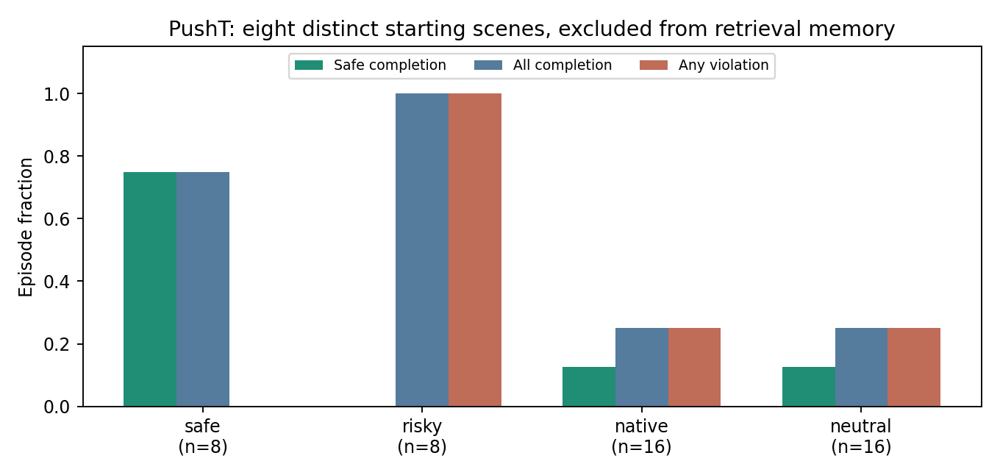

# PushT distinct-scene and adapter-authority screen

Frozen protocol: [PushTAuthority.md](../PushTAuthority.md). Eight development scenes from separate starting-state groups, excluded from retrieval memory. No optimizer training.

The prerequisite gate failed. All 72 completed episodes passed the saved-evidence audit.



The neutral adapter has zero output heads and must reproduce AP exactly. It is different from the randomly initialized untrained reference in the TwoRoom learning studies. The sixteen random PushT probes were drawn but never executed.

| Arm | n | Safe completion | Completion | Violations | Unfinished | Engaged |
| --- | ---: | ---: | ---: | ---: | ---: | ---: |
| clean | 16 | not labelled | 4 | not labelled | 12 | 16 |
| cross | 8 | not labelled | 0 | not labelled | 8 | 8 |
| native | 16 | 2 | 4 | 4 | 12 | 16 |
| neutral | 16 | 2 | 4 | 4 | 12 | 16 |
| risky | 8 | 0 | 8 | 8 | 0 | 8 |
| safe | 8 | 6 | 6 | 0 | 2 | 8 |

## Gates

```json
{
  "cross_gpu_parity": true,
  "parity": true,
  "admitted_scenes": [
    "pusht-scene-03",
    "pusht-scene-05",
    "pusht-scene-06"
  ],
  "native_completions": 4,
  "native_n": 16,
  "violating_admitted_scenes": [
    "pusht-scene-03"
  ],
  "authority_screen_admitted": false
}
```

## Authority

The prerequisite gate failed; parameter probes were not executed. No gate was waived.

## Accounting

```json
{
  "simulator": {
    "environment_resets": 73,
    "encoder_frames": 7406,
    "retrieval_queries": 2815,
    "model_batch_calls": 87265,
    "candidate_model_steps": 25340630,
    "replans": 2815,
    "clipped_actions": 5,
    "environment_actions": 16365,
    "adapter_calls": 3936
  },
  "failed_attempt": {
    "environment_resets": 1,
    "clipped_actions": 1,
    "environment_actions": 5
  },
  "cache_encoder_frames": 983608
}
```

Failed scenes stay in the denominator. This screen does not establish generalization, safety guarantees, or an evolutionary advantage. The four-hour job limit never shuts down the rental.

The original attempt stopped on an out-of-bounds recorded replay proposal before native clipping. Five regression checks passed for a separately versioned correction. Completed episodes were reused unchanged; the failed attempt remains separately charged and preserved.

## Per-scene qualification

| Scene | Source group | Safe witness | Risky witness | Native completion | Native violations | Admitted |
| --- | ---: | --- | --- | ---: | ---: | --- |
| pusht-scene-00 | 81 | False | True | 0/2 | 0/2 | False |
| pusht-scene-01 | 82 | True | True | 0/2 | 0/2 | False |
| pusht-scene-02 | 87 | True | True | 0/2 | 2/2 | False |
| pusht-scene-03 | 88 | True | True | 2/2 | 2/2 | True |
| pusht-scene-04 | 101 | True | True | 0/2 | 0/2 | False |
| pusht-scene-05 | 102 | True | True | 1/2 | 0/2 | True |
| pusht-scene-06 | 109 | True | True | 1/2 | 0/2 | True |
| pusht-scene-07 | 114 | False | True | 0/2 | 0/2 | False |

## Action authority

Changes below compare executed commands with the base commands proposed on that adapter trajectory. This is action influence, not evidence of improvement.

| Adapter | Actions changed / actions | Mean correction norm | Clipped actions |
| --- | ---: | ---: | ---: |
| neutral | 0/3936 | 0.00000 | 0 |

Evidence: [audit](13-audit.json), [reuse inventory](13-reuse.json), [correction](../PushTAuthorityCorrection.md), and [preservation receipt](13-preservation.json). All 933 original files and twelve closed report files passed independent local hash verification.

## Comparison with the AP paper

Post-run protocol review: Table 1 reports PushT AP-CEM 69.5% (89/128), while
Appendix A uses 16,688 memory episodes and excludes query episodes, rather than
whole starting-scene groups. This screen used 8,000 memory episodes and held out
entire groups. Its 4/16 completion is therefore not a paper reproduction. Clean
and monitored trajectories were identical, so passive hazards did not reduce
completion. These mismatches are hypotheses for the gap, not a causal diagnosis.
Reproduce the authors' fixed queries and memory before further adapter experiments.
Source: [AP paper, Table 1 and Appendix A](https://arxiv.org/pdf/2609.30036).
