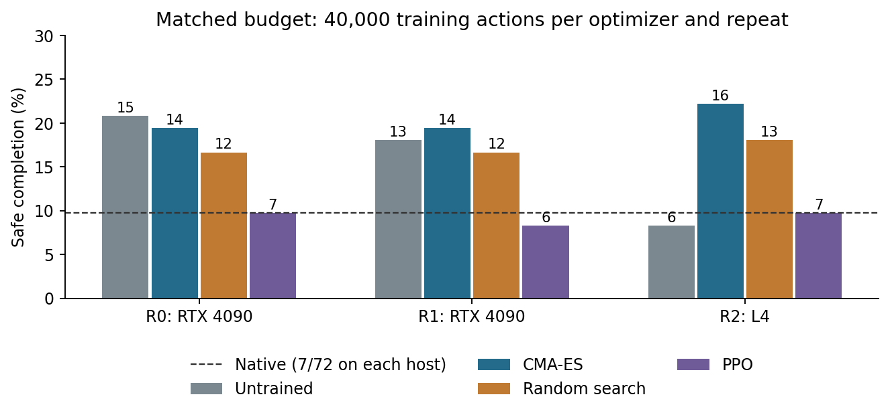

# Matched-objective PPO comparison

Completed 2 November 2026. Both hosts passed audit; all 25,748 archived files
were independently hash-verified locally. This is a separate comparison from
account 12, not another independent set of final layouts.

**Finding:** CMA achieved the highest aggregate safe completion in this study and
beat PPO in all three repeats. PPO did not improve over native AP. Neither the
CMA-minus-PPO nor CMA-minus-random uncertainty interval excludes zero.

## Setup

The same frozen TwoRoom planner and 132-coordinate adapter head, with three fresh
initializations. Every optimizer received exactly 40,000 actual training and
selection actions per repeat. R0/R1 ran on one RTX 4090; R2 ran on one L4. Each
complete CMA/random/PPO comparison stayed on one host. Final evaluation used the
24 previously frozen layouts and three planner seeds. Native was evaluated once
per host. Each trained or untrained row below pools three repeats on the same
layouts; these are not 216 independent tasks.

PPO used the same terminal utility as the evolutionary ranking, with no dense
reward. Its actor matches the selected representation, with a separate critic
and four training-only exploration parameters. Each PPO repeat made ten updates,
using 32,000 collection actions and 8,000 deterministic-selection actions. This
tests one frozen PPO configuration at a small interaction budget.

## Outcomes

| Controller | Safe completion | Completion | Violations | Unfinished | Engaged |
| --- | ---: | ---: | ---: | ---: | ---: |
| Native | 14/144 | 77/144 | 75/144 | 67/144 | 144/144 |
| Untrained | 34/216 | 127/216 | 111/216 | 89/216 | 216/216 |
| CMA-ES | 44/216 | 116/216 | 109/216 | 100/216 | 216/216 |
| Random search | 37/216 | 99/216 | 84/216 | 117/216 | 216/216 |
| PPO | 20/216 | 110/216 | 116/216 | 106/216 | 216/216 |

Violations overlap completion and unfinished outcomes. Engagement does not imply
useful completion.

| Repeat / host | Native | Untrained | CMA | Random | PPO |
| --- | ---: | ---: | ---: | ---: | ---: |
| R0 / RTX 4090 | 7/72 | 15/72 | 14/72 | 12/72 | 7/72 |
| R1 / RTX 4090 | shared R0 native | 13/72 | 14/72 | 12/72 | 6/72 |
| R2 / L4 | 7/72 | 6/72 | 16/72 | 13/72 | 7/72 |

The pre-specified 2,000-draw crossed repeat/case bootstrap, seed 12501, retains
planner seeds and method pairing. CMA-minus-PPO: +11.11 percentage points,
exploratory 95% interval [-6.94, +28.24]. CMA-minus-random: +3.24 percentage points,
interval [-11.57, +18.52]. Three repeats and two hardware blocks limit inference.
The earlier mechanism study instead slightly favoured random search in aggregate;
both results must remain visible. No broad evolutionary superiority or reduced
penalty-tuning claim follows from this study.

## Audit and preservation

All 4,169 episode records passed audit, including incomplete training panels,
recurrent replay, clipped-action likelihood handling, candidate selection and
actual-action budgets. The original 4090 audit falsely rejected nominee order by
0.4693 milliseconds because it compared wall-clock time with filesystem time.
The separate v2 auditor checks selection/specification order on one filesystem
clock and retains the later completed-outcome barrier. Selection precedes the
first R1 specification by one filesystem millisecond. Original code, failure logs
and results remain unchanged; no rollouts were repeated.

Total: 507,387 actions, including exactly 360,000 training/selection actions,
and 3,180,600 model batch calls. Execution took 16,286.7 seconds on the 4090 and
12,281.0 seconds on the L4; these overlapped and should not be added as elapsed
wall time. Audit and transfer are separate.

Frozen protocol: [MatchedPPO.md](../MatchedPPO.md). Machine-readable analysis:
[14-analysis.json](14-analysis.json). Verified archives:
`archive/evidence/ppo-4090-20261101.tar.gz` (16,994 files) and
`archive/evidence/ppo-l4-20261101.tar.gz` (8,754 files).
Rental shutdown remains manual.
