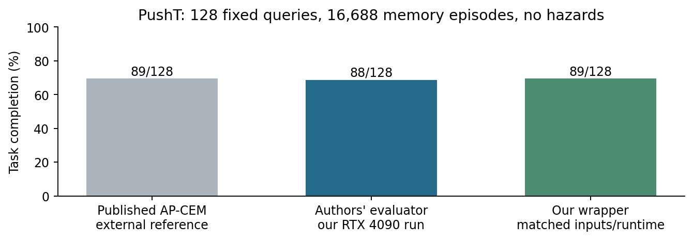

# PushT AP-CEM reproduction and paired wrapper check

Completed 2 November 2026. All 256 evaluation episodes passed audit; all 1,180
archived evidence files were independently hash-verified locally.

**Finding:** the authors' evaluator completed 88/128 and our wrapper 89/128,
compared with the paper's published 89/128. Under matched inputs and runtime,
our wrapper does not show the earlier large performance deficit.

## Matched setup

Public AP revision `984327424ca7a2e52c75a8279197750d9d0b7c8e`; original released
PushT checkpoint and dataset; all 128 recorded clean queries; all 16,688 listed
memory episodes; recorded environment seeds and query-index-derived optimizer
seeds. Query episodes are excluded from memory, but sibling demonstrations from
the same starting scene are allowed, as in the authors' protocol. No hazard is
present, and initially successful queries are not filtered out.

Both arms used the authors' dependency pins in an isolated environment on the
same eight-RTX-4090 host. Hardware differs from the paper's H20, and Python is
3.11.9 rather than 3.11.14. Horizon 140, action cap 280, five-action blocks, 300 CEM
candidates, 30 elites and 30 iterations are unchanged. Full retrieval encoding
used the reference bfloat16 encoder, batch size 128 and float16 cache storage.

The authors' numerical evaluator is unmodified, with only the clean AP-CEM arm
selected in a derived protocol. Our existing wrapper preserves its fp32 online
retrieval encoder, one-neighbour query and pixel preprocessing; a reset shim
separates the recorded environment seed from the optimizer seed.

## Outcomes

| Evaluator | Completion | Unfinished | Engaged | Initially successful |
| --- | ---: | ---: | ---: | ---: |
| Authors' evaluator on our host | 88/128 | 40/128 | 128/128 | 0/128 |
| Our wrapper, matched inputs/runtime | 89/128 | 39/128 | 128/128 | 0/128 |

Both arms succeeded on the same 88 cases and failed on the same 39; our wrapper
completed one additional case. Paired starting states, goals and frames matched
exactly. Recorded and independently rescored physical success agreed in every
episode. This close aggregate agreement is not proof of bitwise equivalence.
The published 89/128 is an external reference, not another run performed here.

## Interpretation

Account 13 removed whole scene groups and used only 8,000 memory episodes. This
experiment instead matches the paper's query panel and memory coverage. The
earlier screen therefore remains a separate, harder generalization result.
The current comparison changes several conditions relative to that screen and
does not isolate their individual causal contributions. In particular, the
fp32-versus-bfloat16 wrapper difference is not supported as the explanation for
the earlier large deficit. No safety or learned-adapter claim is made here.

## Accounting and preservation

256 evaluated episodes plus four transparent-logging engineering checks: 260
resets and 46,417 actions. Full-cache encoding adds 2,336,736 encoder frames,
reported separately from simulator interactions. A missing OSMesa system library
caused a pre-rollout import failure; it was installed and the failure retained,
with zero attempted resets or actions. All four engineering traces matched.

Frozen protocol: [PushTAPReproduction.md](../PushTAPReproduction.md).
Machine-readable audit: [15-analysis.json](15-analysis.json).
Verified archive: `archive/evidence/pusht-ap-reproduction-20261102.tar.gz`.
The cache stays on the rental and is reproducible from the pinned inputs; its
hash and complete coverage are recorded. Rental shutdown remains manual.
