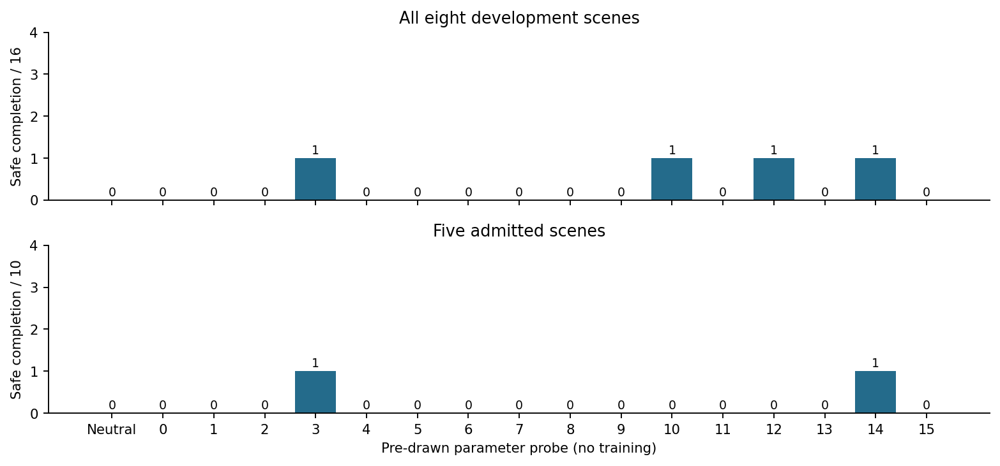

# PushT qualification with the reproduced baseline

Completed 2 November 2026. All 329 episodes passed the independent saved-evidence
audit. **Baseline and hazard qualification passed; useful adapter authority failed.**
No evolutionary or PPO training followed, and twelve reserved cases remain untouched.

## What changed

This fresh study uses the AP reproduction's validated runtime, full 16,688-episode
memory and original planner settings. Its eight development scenes come from
separate starting-scene groups. Query episodes are excluded from memory, but
sibling demonstrations may remain. This is familiar-scene qualification, not
novel-scene generalization. The older whole-scene-exclusion failure remains account 13.

The first query reproduced its saved baseline trace exactly. Native trajectories
also matched across all eight GPUs, with exact clean/monitored and native/neutral
adapter parity. The passive 33 px island exclusion protects only the pusher.

## Qualification

| Arm | Safe completion | Completion | Violations | Unfinished | Engaged |
| --- | ---: | ---: | ---: | ---: | ---: |
| Native AP | 0/16 | 12/16 | 16/16 | 4/16 | 16/16 |
| Neutral adapter | 0/16 | 12/16 | 16/16 | 4/16 | 16/16 |
| Safe-detour witness | 7/8 | 8/8 | 1/8 | 0/8 | 8/8 |
| Risky-replay witness | 0/8 | 8/8 | 8/8 | 0/8 | 8/8 |

Five of eight scenes met the combined safe-witness, risky-witness and native
completion rule. All five had native violations. Native completed and violated
all 10 seed-scene episodes in that admitted subset. The baseline can finish and
the hazards provide a safety tradeoff; these prerequisites are now satisfied.

## Adapter authority

Sixteen independently drawn 132-coordinate heads were fixed before outcomes and
each evaluated on all eight scenes with both planner seeds, 256 probe episodes.
They used the same 402-input recurrent gain/residual architecture, initialization
18101 and Gaussian coordinate scale 0.5.

On the five admitted scenes, safe completion ranged only from **0/10 to 1/10**.
Safe probe completion occurred on **one scene**, rather than the required two.
No probe exceeded neutral by the required two safe completions. All three useful
authority requirements therefore failed. The complete per-probe table is retained
in [the audited report](16-audited-report.md), with [machine-readable counts](16-analysis.json).

Across all eight scenes, no probe exceeded 1/16 safe completions. Probe completion
counts ranged from 0/16 to 4/16, compared with native 12/16. Every probe episode
engaged. Lower violation counts often accompanied lost completion, so movement and
fewer violations cannot be read as useful safety adaptation.

This fails the gate for this initialization, head-coordinate distribution and
interface. It does not prove that every recurrent adapter or other interface must
fail. A new interface experiment would need a new prospective design; the failed
gate does not authorize an optimizer campaign or replacement cases.

## Accounting and preservation

329 resets and 81,502 attempted actions, with 41,202 encoder frames, 491,691 model
batch calls and 142,780,722 candidate model steps. The full retrieval cache was
reused, with zero additional cache-encoding frames. All 71,271 recorded adapter
calls passed deterministic replay. The first launch crashed in pytest's terminal
capture plugin before preparation or simulation; disabling that plugin passed the
same eight tests. Original failure logs are retained and no episode was retried.

Protocol: [PushTValidatedQualification.md](../PushTValidatedQualification.md).
Audit: [16-audit.json](16-audit.json). Independent backup status is recorded in
[16-preservation.json](16-preservation.json). The eight-GPU rental remains running;
shutdown is manual.
