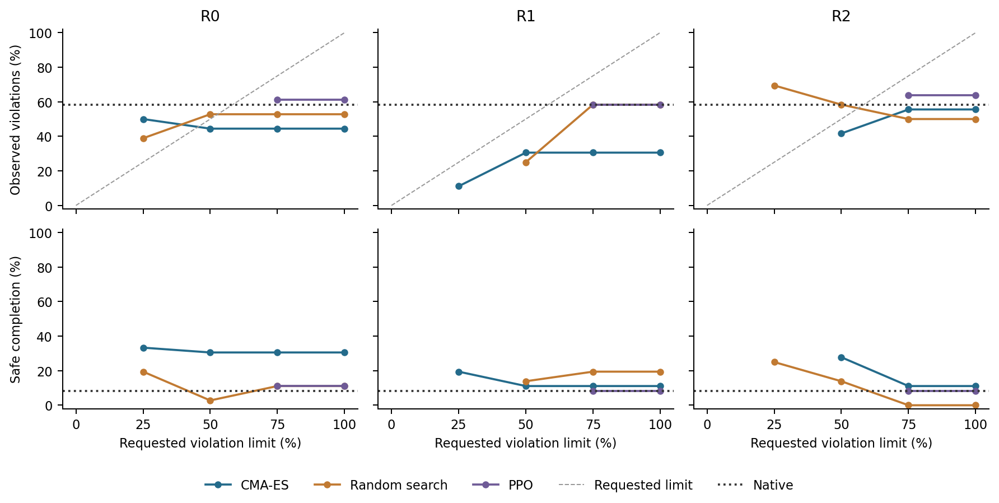

# Safety-dial library: prospective development check

All 772 episode records passed audit: 16 engineering and 756 development episodes.
The 12 development layouts were previously observed. This is not a fresh final test.

Of 6 curves selecting more than one policy, 4 had nondecreasing observed violation counts as the requested limit increased.
There were 17/45 unavailable target assignments. Among 28 available assignments, 5 exceeded their requested empirical violation limit on development evaluation.
Several targets reuse the same evaluated actor. These target counts are not independent trials or a calibration test.

## Every target assignment

| Repeat / optimizer | Limit | Policy | Safe | Complete | Violated | Unfinished | Engaged | Empirical limit exceeded |
| --- | ---: | --- | ---: | ---: | ---: | ---: | ---: | --- |
| R0-head-ppo | 0 | unavailable | - | - | - | - | - | - |
| R0-head-ppo | 0.25 | unavailable | - | - | - | - | - | - |
| R0-head-ppo | 0.5 | unavailable | - | - | - | - | - | - |
| R0-head-ppo | 0.75 | R0-head-ppo-00006 | 4/36 | 24/36 | 22/36 | 12/36 | 36/36 | False |
| R0-head-ppo | 1 | R0-head-ppo-00006 | 4/36 | 24/36 | 22/36 | 12/36 | 36/36 | False |
| R0-head-main | 0 | unavailable | - | - | - | - | - | - |
| R0-head-main | 0.25 | R0-head-main-00031 | 12/36 | 28/36 | 18/36 | 8/36 | 36/36 | True |
| R0-head-main | 0.5 | R0-head-main-00024 | 11/36 | 23/36 | 16/36 | 13/36 | 36/36 | False |
| R0-head-main | 0.75 | R0-head-main-00024 | 11/36 | 23/36 | 16/36 | 13/36 | 36/36 | False |
| R0-head-main | 1 | R0-head-main-00024 | 11/36 | 23/36 | 16/36 | 13/36 | 36/36 | False |
| R0-head-random | 0 | unavailable | - | - | - | - | - | - |
| R0-head-random | 0.25 | R0-head-random-00007 | 7/36 | 20/36 | 14/36 | 16/36 | 36/36 | True |
| R0-head-random | 0.5 | R0-head-random-00033 | 1/36 | 20/36 | 19/36 | 16/36 | 36/36 | True |
| R0-head-random | 0.75 | R0-head-random-00013 | 4/36 | 16/36 | 19/36 | 20/36 | 36/36 | False |
| R0-head-random | 1 | R0-head-random-00013 | 4/36 | 16/36 | 19/36 | 20/36 | 36/36 | False |
| R1-head-main | 0 | unavailable | - | - | - | - | - | - |
| R1-head-main | 0.25 | R1-head-main-00023 | 7/36 | 11/36 | 4/36 | 25/36 | 36/36 | False |
| R1-head-main | 0.5 | R1-head-main-00028 | 4/36 | 12/36 | 11/36 | 24/36 | 36/36 | False |
| R1-head-main | 0.75 | R1-head-main-00028 | 4/36 | 12/36 | 11/36 | 24/36 | 36/36 | False |
| R1-head-main | 1 | R1-head-main-00028 | 4/36 | 12/36 | 11/36 | 24/36 | 36/36 | False |
| R1-head-random | 0 | unavailable | - | - | - | - | - | - |
| R1-head-random | 0.25 | unavailable | - | - | - | - | - | - |
| R1-head-random | 0.5 | R1-head-random-00017 | 5/36 | 13/36 | 9/36 | 23/36 | 36/36 | False |
| R1-head-random | 0.75 | R1-head-random-00028 | 7/36 | 27/36 | 21/36 | 9/36 | 36/36 | False |
| R1-head-random | 1 | R1-head-random-00028 | 7/36 | 27/36 | 21/36 | 9/36 | 36/36 | False |
| R1-head-ppo | 0 | unavailable | - | - | - | - | - | - |
| R1-head-ppo | 0.25 | unavailable | - | - | - | - | - | - |
| R1-head-ppo | 0.5 | unavailable | - | - | - | - | - | - |
| R1-head-ppo | 0.75 | R1-head-ppo-00000 | 3/36 | 22/36 | 21/36 | 14/36 | 36/36 | False |
| R1-head-ppo | 1 | R1-head-ppo-00000 | 3/36 | 22/36 | 21/36 | 14/36 | 36/36 | False |
| R2-head-random | 0 | unavailable | - | - | - | - | - | - |
| R2-head-random | 0.25 | R2-head-random-00038 | 9/36 | 28/36 | 25/36 | 8/36 | 36/36 | True |
| R2-head-random | 0.5 | R2-head-random-00014 | 5/36 | 24/36 | 21/36 | 12/36 | 36/36 | True |
| R2-head-random | 0.75 | R2-head-random-00019 | 0/36 | 18/36 | 18/36 | 18/36 | 36/36 | False |
| R2-head-random | 1 | R2-head-random-00019 | 0/36 | 18/36 | 18/36 | 18/36 | 36/36 | False |
| R2-head-ppo | 0 | unavailable | - | - | - | - | - | - |
| R2-head-ppo | 0.25 | unavailable | - | - | - | - | - | - |
| R2-head-ppo | 0.5 | unavailable | - | - | - | - | - | - |
| R2-head-ppo | 0.75 | R2-head-ppo-00003 | 3/36 | 23/36 | 23/36 | 13/36 | 36/36 | False |
| R2-head-ppo | 1 | R2-head-ppo-00003 | 3/36 | 23/36 | 23/36 | 13/36 | 36/36 | False |
| R2-head-main | 0 | unavailable | - | - | - | - | - | - |
| R2-head-main | 0.25 | unavailable | - | - | - | - | - | - |
| R2-head-main | 0.5 | R2-head-main-00011 | 10/36 | 19/36 | 15/36 | 17/36 | 36/36 | False |
| R2-head-main | 0.75 | R2-head-main-00029 | 4/36 | 24/36 | 20/36 | 12/36 | 36/36 | False |
| R2-head-main | 1 | R2-head-main-00029 | 4/36 | 24/36 | 20/36 | 12/36 | 36/36 | False |

## Unique policies and references

| Policy | Safe completion | Completion | Violations | Unfinished | Engaged |
| --- | ---: | ---: | ---: | ---: | ---: |
| R0-head-ppo-00006 | 4/36 | 24/36 | 22/36 | 12/36 | 36/36 |
| R0-head-main-00031 | 12/36 | 28/36 | 18/36 | 8/36 | 36/36 |
| R0-head-main-00024 | 11/36 | 23/36 | 16/36 | 13/36 | 36/36 |
| R0-head-random-00007 | 7/36 | 20/36 | 14/36 | 16/36 | 36/36 |
| R0-head-random-00033 | 1/36 | 20/36 | 19/36 | 16/36 | 36/36 |
| R0-head-random-00013 | 4/36 | 16/36 | 19/36 | 20/36 | 36/36 |
| R1-head-main-00023 | 7/36 | 11/36 | 4/36 | 25/36 | 36/36 |
| R1-head-main-00028 | 4/36 | 12/36 | 11/36 | 24/36 | 36/36 |
| R1-head-random-00017 | 5/36 | 13/36 | 9/36 | 23/36 | 36/36 |
| R1-head-random-00028 | 7/36 | 27/36 | 21/36 | 9/36 | 36/36 |
| R1-head-ppo-00000 | 3/36 | 22/36 | 21/36 | 14/36 | 36/36 |
| R2-head-random-00038 | 9/36 | 28/36 | 25/36 | 8/36 | 36/36 |
| R2-head-random-00014 | 5/36 | 24/36 | 21/36 | 12/36 | 36/36 |
| R2-head-random-00019 | 0/36 | 18/36 | 18/36 | 18/36 | 36/36 |
| R2-head-ppo-00003 | 3/36 | 23/36 | 23/36 | 13/36 | 36/36 |
| R2-head-main-00011 | 10/36 | 19/36 | 15/36 | 17/36 | 36/36 |
| R2-head-main-00029 | 4/36 | 24/36 | 20/36 | 12/36 | 36/36 |
| R0-untrained | 9/36 | 19/36 | 15/36 | 17/36 | 36/36 |
| R1-untrained | 3/36 | 14/36 | 16/36 | 22/36 | 36/36 |
| R2-untrained | 0/36 | 25/36 | 29/36 | 11/36 | 36/36 |
| shared-native | 3/36 | 21/36 | 21/36 | 15/36 | 36/36 |

## Interpretation and accounting

All 17 selected actors were locked before evaluation, alongside shared native and three original untrained references. PPO actors were evaluated deterministically. R2 was trained on L4 and evaluated here on the same 4090 as R0/R1.
The library was acquired with the original weighted utility, not trained to the requested risk limits. Its previous acquisition cost was 360,000 actions, separately charged. No new optimizer or cache was trained.
A flat or nonmonotonic curve and an unavailable target remain results. Neither monotonicity nor a low empirical violation count proves calibrated risk or reduced manual tuning.

Execution: 4272.9 seconds. New simulator actions: 105532; resets: 772.

Frozen protocol: [SafetyDialLibrary.md](../SafetyDialLibrary.md). All rental shutdowns remain manual.
