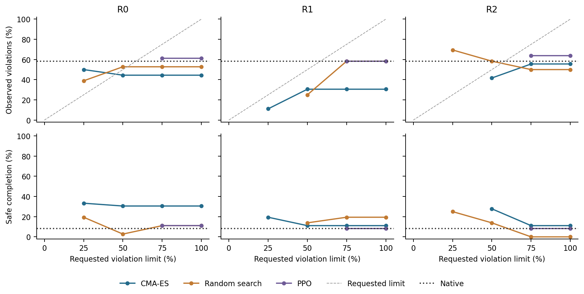

# Safety-dial library: prospective development check

Completed 2 November 2026. All 772 records passed audit and the raw evidence and
report bundles passed independent local hash verification. **Some policy tradeoffs
persisted, but the requested risk limits were not reliably respected.**

## Design

The nine original optimizer/repeat candidate pools from the matched PPO study
provided policies for requested episode-violation limits 0, 0.25, 0.5, 0.75 and 1.
Selection maximized completion subject to the empirical limit on the original
eight training cases. All 17 distinct selected actors were locked before new
rollouts. Shared native and three original untrained references brought the total
to 21 policies, each evaluated on 12 previously observed development layouts with
three planner seeds, 36 episodes per policy and 756 in total.

These are development outcomes, not a new held-out test. Repeated targets selecting
one actor reuse its evaluation. The 28 available target assignments are therefore
not 28 independent risk-estimation trials. PPO actors were deterministic; R2's
library was trained on L4 and evaluated on the same 4090 as R0/R1.

## Results

- **17/45 target assignments were unavailable**, including every zero-risk target.
- **5/28 available assignments exceeded their requested empirical risk limit.**
- Six curves selected more than one policy; **4/6 had nondecreasing violations**
  as the requested limit increased. R0 CMA and R2 random search were nonmonotonic.
- Each PPO repeat selected the same actor at limits 0.75 and 1, with the lower
  targets unavailable. These constant curves do not establish a useful dial.

For example, R0 CMA's 0.25 setting violated in 18/36 episodes, compared with
16/36 at its 0.5 setting. R1 CMA did offer a risk change: 4/36 violations at 0.25
versus 11/36 at 0.5, but task completion was only 11/36 versus 12/36, leaving
25/36 versus 24/36 unfinished. Safe completion was 7/36 versus 4/36.

Shared native had 3/36 safe completions, 21/36 completions, 21/36 violations and
15/36 unfinished episodes. Every evaluated policy engaged in 36/36 episodes.
Completion and violations may overlap. The [full report](17-audited-report.md)
retains all 45 target assignments and all 21 unique-policy/reference rows,
including completion, violations, unfinished episodes and engagement.

## Interpretation

The library was acquired using the original fixed weighted utility, not trained
to these risk limits. This demonstrates limited policy choice, not calibrated
violation probabilities, risk-conditioned training or reduced manual tuning.
Monotonicity alone cannot establish calibration; low violations accompanied by
unfinished tasks are not sufficient evidence of useful safety adaptation.

## Accounting and preservation

16 engineering plus 756 development episodes: 772 resets, 105,532 actions,
58,375 encoder frames, 659,742 model batch calls and 191,580,564 candidate model
steps. All 16 native/neutral parity checks passed, and 99,804 adapter calls passed
deterministic replay. The audit verified 75 source bindings. Execution took
4,272.9 seconds, excluding audit and preservation. No failed execution or retry
was needed. The original library acquisition cost of 360,000 actions remains
charged separately; no new optimizer training or cache encoding occurred.

Protocol: [SafetyDialLibrary.md](../SafetyDialLibrary.md).
Evidence: [analysis](17-analysis.json), [audit](17-audit.json),
[verified backup](17-preservation.json) and [figure provenance](17-figure-provenance.json).
All 4,748 raw archive members and six report members passed hash verification.
Rental shutdown remains manual.
