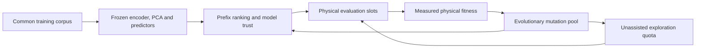

# Phase 3, Part 3: model-assisted evolution with correction-dependent trust

**Date:** 18 October 2026.

**Status:** its feasibility stage completed on 18 October 2026. Eight common recording
episodes were collected and the model was trained. Four-action ensemble error was
45.1% worse than persistence; the main readout was inaccurate even on actual future
observations, and correction-dependent trust collapsed to the disagreement reference.
The 64-episode optimizer comparison was not launched. The
[completed report](docs/research/reports/ManiGuard%20Part3%20model%20assisted%20evolution.md)
and frozen audit retain these results.

**Prospective repair, 19 October 2026:** follow the
[shared recovery plan](phase3Recovery.md#3-part-3-repair-readouts-before-dynamics).
Repair and validate actual-state readouts first; compare simple residual dynamics
against persistence; replace unsupported correction bins with a supported, regularized
calibration rule or omit the correction-dependent arm. Use a finite development queue
and a fresh model audit. The direct physical evolutionary comparison can proceed
without a predictive model. A failed forecast candidate no longer implies immediate
provider shutdown or completion of the whole recovery goal.

**Working scope:** one frozen ManiGuard Clutter policy, one compact controller family,
a small predictive model and a controlled evolutionary-method comparison. The proposed
physical pilot contains 64 full episodes, with a separately identified eight-episode
data-collection option. The allocation and timing decision remain open until the data
and engineering audit. Neither budget is added automatically to the current rental.
The sections below preserve the original prospective design. Its host ID, timestamps,
unexecuted stages and old finish-at-gate rule are historical; a recovery experiment
requires a new namespace, protocol and allocation under the shared recovery plan.

## 1. Research question

> Can prediction errors associated with execution corrections help evolutionary search
> choose which mutations to evaluate physically, improving safe completion under a fixed
> simulator-interaction budget?

Part 2 asks when a changed action should prompt fresh VLA feedback. Part 3 asks when a
predictive model deserves trust while selecting controllers to test. The model guides
the allocation of physical evaluations. Actual measured outcomes determine evolutionary
fitness, parent selection and the deployed finalist.

Three hypotheses organize the investigation:

1. Prediction quality differs between ordinary execution and states/actions affected by
   intervention, beyond what ensemble disagreement alone explains.
2. A short-horizon model can rank useful motion mutations on appropriately supported
   training contexts without predicting an entire task.
3. Accounting for observed errors conditional on correction improves that ranking and
   subsequent physical search compared with disagreement-based model assistance.

These are unverified hypotheses. A useful negative result would identify inadequate
visual information, unreliable dynamics, an ineffective acquisition rule or insufficient
evidence, rather than presenting imagined safety as physical improvement.

## 2. Intended contribution and nearby work

The intended contribution is a tested way to allocate evolutionary evaluations using
the reliability of predictions after intervention. It requires evidence that the
allocation rule helps, with the controller, training data and physical budgets matched.

The ingredients have substantial precedent:

| Prior work | Established ingredient | Consequence for this experiment |
| --- | --- | --- |
| [DINO-WM](https://arxiv.org/abs/2411.04983v2) | Predicting visual features from actions for planning | A frozen encoder and feature predictor are a starting point, not novelty by themselves. |
| [Dynamics-Aware Quality-Diversity](https://arxiv.org/abs/2109.08522v1) | Dynamics models supporting evolutionary skill exploration | Model-assisted evolutionary search already exists. |
| [Model-Based Policy Optimization](https://arxiv.org/abs/1906.08253v3) | Short model rollouts starting from recorded states | Keeping predictions short addresses an established problem with model bias. |
| [When World Models Lie](https://arxiv.org/abs/2609.34300v1) | Adapting latent safety reasoning using observed prediction errors | Observed error versus ensemble disagreement is an existing distinction. |

The proposed difference concerns correction-dependent reliability in the allocation of
physical evolutionary tests around a frozen manipulation policy. This targeted reading
does not establish novelty. Recheck the nearest acquisition, surrogate-assisted evolution
and model-calibration methods before making a paper-level novelty claim.

## 3. Fixed system and separation of components

Retain ManiGuard, the source/checkpoint pins, task definitions, 20 Hz action frequency,
120 Hz physics frequency and native 1,100-action Clutter horizon from
[Part 1](phase3Part1.md). Use the existing single-GPU simulation/policy environments.
Keep the VLA frozen. Evolve controller parameters, not the VLA or world-model weights.

Every optimizer deploys the same controller family with the same permitted inputs:
policy commands, robot proprioception and causal executed-action history. The visual
model and its readouts are used during training-time candidate selection. They do not
add privileged inputs or a different online policy to one method.

The unchanged ManiGuard monitor evaluates physical violations. The proposed predictor
is not an installed or validated ManiGuard safety filter. The first pilot does not add
a learned online action veto, reachability controller or certified backup. An online
filter extension would require its own validation and filter/no-filter comparisons.



## 4. Data inventory and recording requirements

The audited Part 1 training pool contains 24 full episodes, 17,318 policy actions and
one violating episode across two scenes. Its exposed comparison episodes must not
become training or calibration data for this study. The
[pilot report](docs/research/reports/ManiGuard%20evolutionary%20safety%20dial%20pilot.md)
and [failure investigation](docs/research/reports/ManiGuard%20Part1%20failure%20investigation.md)
retain the evidence and limitations.

Part 1 preserves action/state traces, native videos and exact initial observations.
Camera hashes at later queries do not contain the image data. Video-decoded frames are
lossy observations and must not be described as exact VLA inputs or silently mixed with
raw observations. No ready-trained Clutter world model or calibrated safety readout has
been validated on this instance.

The preferred reusable recording consists of:

- Exact overview/wrist RGB and robot measurements at query start and four actions later,
  with one-step transitions where needed for model fitting.
- Original chunks, controller outputs and final environment-input commands, in their
  original units and dtypes, plus grasp-heuristic and query-trigger events.
- Native Boolean monitor and goal traces, unchanged.
- Evaluation-only numerical uprightness measurements using the pinned scene's protected
  objects, up-axis convention and tilt thresholds. Record per-object values and IDs.
- Evaluation-only target/goal geometry for a short-term progress readout, without feeding
  these measurements to the live execution controller.

Prefer a bounded common capture of every control observation for model-training episodes
if storage/latency permit it; query-boundary pictures alone do not supply one-step visual
dynamics. Fix the capture schedule and benchmark its overhead before collection.
If subsampling is necessary, preserve paired observations at each selected start and
one action later, plus four-action audit endpoints and every intervening command. Never
fill missing observations by interpolation and treat them as recorded physical data.
Capture observations already extracted by the evaluator; do not advance physics or
trigger extra rendering to construct training pairs.

An optional passive recording amendment can be prepared before Part 2 freezes, applied
identically to all four conditions. It must not change Part 2's controller inputs,
ranking, episode count or outcome semantics. Part 2 proceeds without any dependency on
training this model. If the amendment is impractical, declare the missing data and cost
separate collection under section 10.

## 5. Representation and compact dynamics

Working defaults, subject to the offline audit, are:

| Component | Proposed starting point |
| --- | --- |
| Vision | One frozen DINOv2 small encoder with a pinned public checkpoint and preprocessing |
| Spatial information | Fixed spatial patch pooling from both cameras; avoid assuming global pooling retains small-object tilt |
| Compression | Training-only standardization and PCA, initially 32 visual coordinates |
| Robot measurements | Arm joints and both finger positions, separately standardized and retained outside PCA |
| Memory | A short causal observation/action history for contact and grasp ambiguity |
| Dynamics | Five small episode-bootstrap residual MLP predictors; ridge/persistence references |
| Prediction horizon | One action for fitting/auditing, up to four actions for candidate screening |

In schematic form:

```text
z_t = PCA(encoder(overview_t, wrist_t))
x_t = [z_t, robot_measurements_t, causal_history_t]
x_hat_(t+1) = F_i(x_t, u_t), for ensemble member i
```

Here `u_t` is the recorded environment-input command, including its gripper coordinate.
It is not a measured actuator torque or the proposal before adaptation. Preserve the
lower-level controller configuration because its clipping/dynamics remain part of the
mapping being learned. Record proposals separately for computing corrections.
Predict the next visual/robot measurements and shift history deterministically rather
than learning a separate, potentially inconsistent copy of the past.

PCA is compression. The action-conditioned predictor supplies the dynamics. Fit the
encoder preprocessing, PCA and scalers on model-fitting data only, then freeze them.
Compare PCA with uncompressed pooled features and a same-size random projection offline.
High explained variance is not evidence that safety-relevant information survived.

Use separate readouts to estimate uprightness margin and short-term target progress.
Numerical margins require new evaluation instrumentation; they cannot be reconstructed
from the old Boolean monitor exports. Uprightness is only one safety component: a good
tilt predictor does not establish spill/drop detection or full-task safety.
Spatial progress does not establish the native held-object goal or requested completion;
those remain separate physical outcome checks.

## 6. Controller representation held common across methods

Start from Part 2's execution controller. A proposed four-coordinate domain is:

| Coordinate | Working values |
| --- | --- |
| Free-motion joint-target error cap, radians | disabled, 0.12, 0.08, 0.04 |
| Grasp-conditioned cap, radians | disabled, 0.08, 0.04, 0.02 |
| Accumulated correction threshold | 0, 0.5, 1, 2, disabled |
| Minimum query interval, actions | 4, 6 |

Fix the maximum ordinary interval at eight and smoothing at one. A disabled threshold
gives interval eight; threshold zero gives the selected fixed minimum interval. Disabled
caps plus a disabled threshold preserve the original commands and eight-action schedule.

For a working normalization, accumulate arm-command correction norms divided by
`sqrt(7) * 0.04 rad`, resetting at each query. Reuse Part 2's exact definition if it has
already been frozen; do not reinterpret its measurements. The numerical threshold domain
above must be checked against that definition and recorded-input activation before freeze.

The grasp rule and componentwise versus direction-preserving cap mapping must be identical
across methods. Any repair motivated by Part 1 must be decided before this comparison,
with all methods using it. The model-assisted arm must not receive a better controller
representation than plain evolution.

## 7. What the model can legitimately compare

Freeze a common bank of training query-start contexts and their returned VLA chunks.
For each motion mutant, apply its controller to the first four proposed actions, updating
predicted robot state/history causally. Roll the predictor forward only over that prefix.
All candidate controllers have a minimum query interval of at least four.

Do not invent future VLA chunks or query the VLA for imagined camera observations. Do not
claim that four-action screening predicts final task success. A prospective screening
order is: fewer predicted uprightness-threshold crossings, then greater predicted
short-term goal progress, then less departure from the nominal commands, with fixed
birth-order ties. Normalize and aggregate the context bank identically across methods.
Readout accuracy and this ordering must pass the offline checks before use.

The four-action prefix cannot identify the effects of changes that only alter later
query timing. Route timing-only mutations to physical exploration without model ranking.
Do not let a model select against a gene whose consequences it has not predicted.

Counterfactual predictions are conditioned on logged starts, not simulator branch replays.
No exact physics snapshot/restore is assumed. Out-of-support candidates cannot acquire a
trusted score merely because the ensemble members agree.

## 8. Evolutionary methods and correction-dependent trust

Compare three methods in the first pilot:

| Method | How motion offspring are chosen for physical evaluation |
| --- | --- |
| E: plain evolution | Uniform selection from the common mutation pool |
| M: model-assisted evolution | Prediction ranking with an ensemble-disagreement trust rule |
| C: proposed method | The same ranking with trust informed by observed error conditional on correction |

All methods share population size, initialization, parent selection, mutation operators,
real evaluation panels, fitness and finalist confirmation. Model-assisted methods share
the encoder, PCA, dynamics ensemble, readouts and training corpus. Freeze these artifacts
before the optimizer comparison. Do not update a model using only its own method's new
episodes during the primary pilot; retain those trajectories for later analysis.
Use the top two physically ranked initial controllers as eligible parents, with the
same seeded parent-draw procedure in all methods.

The proposed trust rule uses factual calibration windows:

```text
correction = accumulated normalized difference between proposal and environment input
error      = normalized difference between predicted and subsequently observed latent
```

Fit a small calibration rule relating error to correction magnitude, with ensemble
disagreement as a common input/reference. A coarse conditional-quantile lookup is the
first candidate; avoid a large uncertainty network. Use whole-episode calibration groups.
Sparse bins inherit a conservative unconditional fallback; unsupported regions abstain.
This is an empirical reliability rule, not a formal safety or coverage certificate.

For an unexecuted mutant, correction magnitude is planned from its simulated prefix;
it is not an actual measured execution. Keep planned and factual values distinct. Only
after real execution may its prediction residual enter a future calibration dataset.

An abstention removes the model's recommendation, not the candidate's eligibility for
physical exploration. Set M and C to the same nominal acceptance fraction on calibration
data so that simply abstaining more is not the intended explanatory difference. Freeze
the fraction and thresholds before the forecast audit; report actual acceptance rates.

Each new four-slot population contains:

1. One retained elite, physically re-evaluated.
2. One unassisted timing/exploration mutation.
3. Two motion mutations from a shared pool, selected according to E, M or C.

Use up to sixteen distinct cap-mutant proposals from the eligible parents, holding their
query coordinates fixed. All methods receive the same generation procedure and pool
budget. If trustworthy rankings cannot fill the two slots, fill them by the same seeded
random fallback. Log every proposed, ranked, abstained, selected and discarded genome.
This quota prevents the model from controlling every physical evaluation.

## 9. Offline feasibility stage

Create separate model-fitting, calibration and forecast-audit groups before fitting.
Group entire trajectories, seeds and source-task variants; never split adjacent frames
randomly. Prefer distinct development scenes. If the available corpus cannot support
those groups, report the limitation and use only the predeclared collection option.

Required checks are:

- Compare one- and four-action predictions with persistence, ridge and action-shuffled
  references. Include changing-state windows so copying a static scene cannot dominate.
- Test whether actual future latents retain uprightness/progress information, then test
  readouts on predicted future latents. This separates representation/readout problems
  from dynamics problems.
- Report prediction error and false reassurance near the uprightness threshold, by
  correction magnitude, scene and episode. Report the independent event denominator.
- Compare M and C at matched nominal acceptance, measuring whether trusted predictions
  actually have lower consequential errors. Do not equate disagreement with calibration.
- Audit short-horizon ranking against available measured motion/outcome changes, without
  fitting to the final physical comparison.
- Measure feature extraction, fitting, screening latency, storage and memory.

Before opening the forecast-audit groups, freeze numerical pass/inconclusive criteria:
required improvement over persistence, acceptable readout error near the constraint,
minimum episode/event support, interval-width or abstention limits and ranking usefulness.
These thresholds are engineering/research choices requiring the inventory, not universal
constants supplied by this plan. A held-out calibration check is not final task evidence.

Proceed to model-assisted physical search only if the model carries useful action- and
safety-relevant information under those criteria. Otherwise finish with the diagnostic
and its costs. Do not repeatedly enlarge the dataset or relax criteria until it passes.
One violating training episode cannot establish a calibrated rare-failure probability.

## 10. Proposed bounded physical allocation

The core pilot has two evaluated populations per method: a shared initial population
and one genuinely selected descendant population.

| Work | Calculation | Full episodes |
| --- | --- | ---: |
| Shared initial population | 4 controllers x 2 training scene/seed cases | 8 |
| Descendant populations | 3 methods x 4 controllers x 2 fresh training cases | 24 |
| Finalist confirmation | 3 methods x 2 shortlisted controllers x 2 new training cases | 12 |
| Fresh comparison | identity, one fixed reference and 3 frozen finalists x 4 matched blocks | 20 |
| Core pilot total | Shared initial population counted once | 64 |

Reusing the shared eight records gives every method the same initialization; do not count
them as 24 interactions. Identical later genomes are still re-evaluated under the declared
method slots. Preserve duplicate/neutral phenotypes and their costs.

Before model fitting, choose whether a separate **eight-episode common recording batch**
is required by data availability/partitioning. A working design is two additional training
scenes, two predeclared fixed execution settings and two seed repetitions. That gives a
maximum proposed scope of **72 full episodes**. It is not an outcome-triggered expansion
after a failed forecast audit. Freeze its inclusion and cases before collecting outcomes.

Core and augmented maxima are respectively **70,400** and **79,200** policy control
actions at the native horizon. Initialization, bounded engineering checks, failed attempts
remain counted costs. The working engineering allowance is at most three 32-action
attempts, or 96 additional policy actions. Initialization physics is additional and
measured. Failed full-episode attempts consume their scheduled slots; there is no
automatic full-episode retry or replacement. An unfinished job has invalid/incomplete
evidence, not an imputed task-failure fitness. Stop dependent selection if required
measurements are missing. Any changed allowance needs a new recorded allocation decision.

Part 1/2 donor trajectories are prior physical experience, not free data. Report their
historical acquisition costs, the marginal new costs, and a cumulative unique-interaction
ledger. Common acquisition is charged once in the actual allocation and disclosed as an
equal information endowment across methods. Do not double-count a shared episode as new
work in two studies.

This is a proposed allocation, not a promise that 64 or 72 episodes fit the remaining
current rental. If only the offline stage fits, preserve it and leave physical work queued.

## 11. Selection, panels and frozen comparison

Use two declared training cases per candidate, common across methods within a population.
Descendants and copied elites receive fresh cases. Rank measured mean
`U = int(S_req) - 2 * int(V)`, with fixed birth-order ties, matching the existing physical
outcome contract. This pilot does not make a penalty-free selection claim.

Shortlist two controllers from each method's final population. Give both two new common
training cases. Select one finalist using its four equally weighted observations from
that final-population evaluation and confirmation; earlier initial-population scores do
not substitute for re-evaluation. Freeze one controller per method before comparison.

The fixed reference comes from Part 2's fixed-frequency restrained conditions B/C, using
a predeclared training-only rule: higher mean U, then fewer queries, then B. If Part 2
does not supply a complete comparison, declare the fallback fixed reference before any
Part 3 outcome. Do not choose a reference after looking at Part 3 results.

Use two still-unopened Clutter validation scenes and two repetitions per scene for the
four comparison blocks. `task_0048/base` and `task_0050/base` are proposed candidates
from the [existing split manifest](configs/maniguard/phase2/splits.json); verify their
exposure and assets before freezing them. Part 1's `task_0029` and `task_0032` are exposed.
Keep the main-study test partition untouched.

Freeze scene IDs, seeds, model partitions, context-bank membership, optimizer RNG seeds,
condition order and all selection rules before the respective outcomes are opened.
Interleave methods/conditions to limit machine-time confounding. Matching seeds does not
ensure identical images or physical trajectories. Preserve initial observations and
policy RNG receipts.

## 12. Analysis and limits of the pilot

The primary method contrast is C versus M: does correction-dependent trust help beyond
ensemble-based assistance? E tests whether model assistance adds useful value at all.
Identity and the fixed reference expose whether search improves a meaningful controller
baseline. Report all contrasts even if the proposed method loses.

Keep safe completion, violations, unsafe completion and unfinished episodes together.
Show per-scene/block counts, query cost, intervention magnitude, model abstentions,
random fallbacks, prediction errors and physical outcomes of model-preferred mutations.
Report cumulative physical search curves, then show the fresh comparison separately.

One optimizer seed and one evolutionary transition per method provide a mechanism pilot.
Four fresh episodes per finalist do not establish broad superiority or a low violation
probability. Preserve denominators and uncertainty; do not treat correlated frames or
repeated controller evaluations as independent trials. Zero violations is not zero risk.

A larger contribution study requires repeated optimizer seeds, matched random search and
ordinary learning over the same controller representation with equivalent data, feedback,
confirmation and interaction budgets. The existing categorical policy-gradient machinery
in [unisafe_search.py](experiments/helpers/unisafe_search.py) is a possible starting point.
Omitting these arms from the 64-episode pilot limits its claims; it does not make those
comparisons optional for an eventual evolutionary-advantage claim.

Keep PCA/no-PCA and trust/abstention ablations offline where possible. A random or
disagreement-only selector matching C is informative evidence against the proposed
mechanism. An improved readout without improved physical completion is reported as a
prediction result, not a successful safety controller.

## 13. Resources, deadlines and implementation boundaries

Reuse the validated RTX 4090 instance `56582094`; do not replace its host driver or run
the UNISafe installers. Use uv with each intended environment's explicit interpreter.
Place feature/model tooling in an explicitly owned environment, without root-syncing
dependencies into either ManiGuard environment. Cached features permit CPU fitting and
screening where practical; verify rather than assume their cost.

Count encoder calls, dynamics-member evaluations, VLA queries, physical actions,
initialization ticks, fitting time and allocated GPU-hours separately. Freeze training
updates, seeds and model-query caps. Offline model queries are not physical evidence,
and fitting a model does not erase the acquisition cost of its corpus.

For any work on the current allocation, preserve **2026-10-18 16:00:37 UTC** as the
original start, **2026-10-18 23:00:37 UTC** as the physical-work target and
**2026-10-19 00:00:37 UTC** as the hard deadline. Part 2, implementation, model work,
failures, reporting and idle rental all count. Part 3 creates no new eight-hour window.
A later physical allocation needs a separate explicit allocation record.

Use measured end-to-end timing, model overhead and remaining time to select a feasible
scope before outcomes. Supervise experiment process groups independently; do not begin
jobs that cannot fit the frozen allowance. Keep the rental running as requested by the
user while stopping experiment processes within their limits. No rental-stop request is
part of this plan.

Add new helpers/scripts under names such as `maniguard_part3_*`. Preserve Part 1's frozen
implementation and its `maniguard_phase3_*` file set. Use new output directories and
source/checkpoint hashes. Do not resume archived studies or overwrite recorded evidence.

## 14. Deliverables and decisions required before execution

Deliver a frozen data manifest and partitions; feature/PCA/scaler receipts; model and
readout checkpoints; calibration evidence; mutation pools and complete lineage; candidate
selection/abstention records; three frozen finalists; all attempted interactions and
query/time costs; matched videos; outcome and prediction figures; and an audited concise
report using the repository's GECCO template when physical comparison is available.
Keep generated datasets, run directories and checkpoints out of Git. Store trained
checkpoints privately with revision pins; commit code, protocol, provenance and the report.

CPU checks should cover identity, units, causal action history, accumulator resets,
prefix/query boundaries, no invented future VLA actions, train/calibration separation,
PCA freezing, deterministic selection/fallback, shared-initial accounting and supervisor
cleanup. Physical engineering checks are bounded, separately counted prerequisites.

The execution freeze must resolve:

1. Exact recording availability and whether the eight-episode common batch is included.
2. Encoder/checkpoint, spatial pooling, PCA dimension, history, model/readout architectures,
   training-update cap and complete data partitions.
3. Controller domain, correction normalization, grasp rule and shared restraint mapping.
4. Context bank, screening order, calibration rule, acceptance fraction, sparse-support
   fallback and numerical forecast-gate criteria.
5. All scene/seed assignments, mutation pools, finalist confirmation and condition order.
6. Engineering/retry caps, timing feasibility and the applicable allocation/deadlines.

The original queue order was **Part 2 physical mechanism test, Part 3 model feasibility,
then the bounded Part 3 optimizer comparison if its prerequisites and allocation support it**.
The recovery plan now specifies the next work. An adverse or incomplete result remains
recorded evidence; a feasibility diagnostic alone does not complete its comparison goal.
