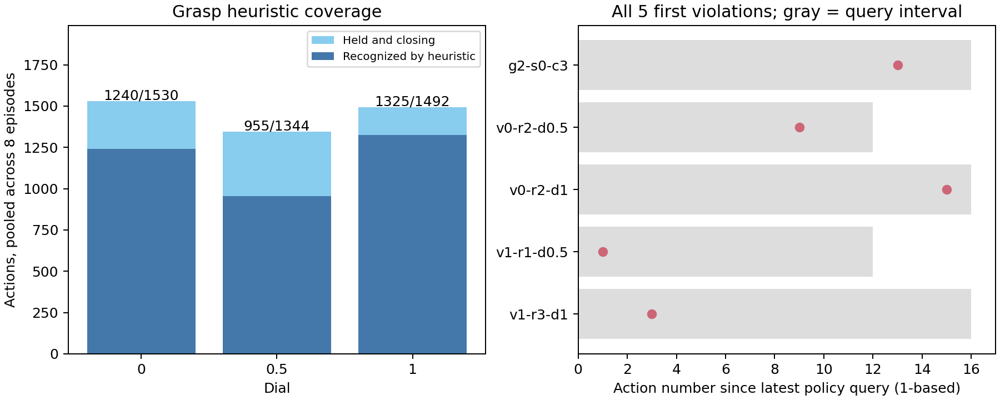

# ManiGuard Part 1: small failure investigation

18 October 2026. Exploratory analysis after the frozen pilot, using all 48 full
episodes already recorded. **No additional policy query, simulator action or optimizer
run was performed.** The [original report](ManiGuard%20evolutionary%20safety%20dial%20pilot.md)
and frozen controller remain unchanged. Safe completion was 5/8, 3/8 and 4/8 at dial
0, 0.5 and 1, respectively; violations were 0/8, 2/8 and 2/8.

The strongest concrete finding is a gap in grasp detection. The remaining evidence
points to controller geometry, confounded query scheduling and weak selection evidence.
These are hypotheses with testable repairs, not established causes or demonstrated fixes.

| Hypothesis | Evidence from this pilot | Smallest useful repair or test |
| --- | --- | --- |
| The grasp heuristic misses valid assisted grasps. | At full strength it missed all 167 held, closing actions in the unsafe liquid-transport episode `v0-r2-d1`. One finger was about 0.040 m at the violation, outside the required 0.003 to 0.035 m band. The controller consequently selected the 0.04 rad free cap instead of its 0.02 rad grasp cap. | Audit finger asymmetry and band coverage on training traces. Compare a uniform cap against a grasp-conditioned cap; calibrate any replacement detector using training evidence only. Native held labels remain audit labels, not extra online information. |
| Independent joint caps can disrupt coordinated motion without controlling the actual safety condition. | All five first violations concern container or obstacle uprightness. Full-strength clipping changed joint-space target-error direction by more than 5 degrees on 215/325 substantially changed actions, with a maximum of 46.8 degrees. | Compare direction-preserving scaling of the whole joint-error vector against componentwise clipping, holding query horizon fixed. An orientation-aware variant would need its own information declaration and physical test. |
| Longer query prefixes contribute to some failures. | The dial changed both command restraint and feedback interval: 8, 12 and 16 actions. One full-strength violation occurred on action 15/16 after a query, but others occurred on actions 1/12 and 3/16. | Isolate caps and horizon in a four-condition screen: caps off/on crossed with horizons 8/16. Early-query violations are counterevidence to a universal stale-feedback explanation. |
| Evolution selected on evidence too weak to establish a robust winner. | Each candidate measurement used two episodes. Five of twelve measurements reached the maximum score; only ten distinct genomes were evaluated. The repeated elite scored 1, 1 and 0.5 on successive fresh seed pairs. All sixteen matched initial comparisons already had different first policy commands before adaptation. | Check inference repeatability on identical saved inputs, then rendering repeatability. Allocate subsequent search effort to repeated training evaluations and strong fixed baselines before adding generations. |

The grasp gap is measurable, but repairing it is not sufficient on present evidence.
The heuristic also missed 290 held actions in a safe identity episode and 389 in a safe
midpoint episode. Conversely, it correctly recognized the grasp at both obstacle-uprightness
violations. Across comparison episodes, every missed held-and-closing action had a finger
outside the band; there were no heuristic-positive actions labelled unheld in these traces.
Action counts within episodes are correlated and are not independent trials.

| Dial | Recognized held-and-closing actions | Coverage | Misses outside finger band |
| --- | ---: | ---: | ---: |
| 0, diagnostic only | 1,240/1,530 | 81.0% | 290 |
| 0.5 | 955/1,344 | 71.1% | 389 |
| 1 | 1,325/1,492 | 88.8% | 167 |



The caps limit commanded joint-target error relative to measured joints. They do not
directly bound measured velocity, wrist orientation, object tilt or collision. The
reported direction angles are seven-dimensional joint-space calculations, not measured
object or end-effector rotations. No alternate command was physically tested. The
finalist's smoothing coefficient was 1, so historical-action smoothing is not a supported
explanation for its failures.

All five first violation boundaries are retained below, including the discarded training
candidate. Each picture contains both native cameras at one second before the boundary,
the boundary and one second after. Frames were decoded from existing videos. The
[complete matched videos](maniguard-phase3-part1-gecco/videos.md) retain every comparison
block. Uprightness flags identify the monitored event; pictures alone do not identify
which earlier contact or command caused it.

| Episode | First observed step | First failed proposition | Action within query prefix | Held / grasp heuristic before action | Anchor cap active on preceding 20 actions | Pictures |
| --- | ---: | --- | --- | --- | ---: | --- |
| Training `g2-s0-c3` | 445 | container upright | 13/16 | yes / no | 0/20 | [Both cameras](../figures/ManiGuard/phase3-part1-diagnostics/first-violations/g2-s0-c3.png) |
| `v0-r2-d0.5` | 345 | container upright | 9/12 | no / no | 0/20 | [Both cameras](../figures/ManiGuard/phase3-part1-diagnostics/first-violations/v0-r2-d0.5.png) |
| `v0-r2-d1` | 335 | container upright | 15/16 | yes / no | 7/20 | [Both cameras](../figures/ManiGuard/phase3-part1-diagnostics/first-violations/v0-r2-d1.png) |
| `v1-r1-d0.5` | 421 | obstacles upright | 1/12 | yes / yes | 9/20 | [Both cameras](../figures/ManiGuard/phase3-part1-diagnostics/first-violations/v1-r1-d0.5.png) |
| `v1-r3-d1` | 355 | obstacles upright | 3/16 | yes / yes | 7/20 | [Both cameras](../figures/ManiGuard/phase3-part1-diagnostics/first-violations/v1-r3-d1.png) |

At these first boundaries, the other spill/drop propositions were false. This does not
claim they remained false later. A violation observed at step `k` follows command `k-1`;
the held label used for that command is the preceding goal observation. Initial held
state is unknown and excluded. A reporting tolerance of `1e-6` rad separates substantial
command changes from floating-point differences: 0, 205 and 325 comparison actions cross
that threshold, versus the original exact-change counts of 0, 300 and 412. The original
counters and controller were not changed.

Initial robot input state was exactly equal in all sixteen identity-versus-adapted pairs,
but camera hashes differed in every pair. The first arm proposals differed by maximum
joint deviations of 0.000192 to 0.000743 rad while neither first action was substantially
adapted. This establishes a pre-intervention difference, not whether rendering sensitivity
or inference nondeterminism caused it, or whether it explains later outcome differences.
The aggregate adverse observations still stand. Episode-level counterfactual claims
need stronger repeatability controls.

The sole within-generation one-coordinate contrast was final-generation slots 1 and 3:
identical caps and horizon, smoothing 1 versus 0.5, scores 1 versus -0.5. Different
rendered inputs and only two outcomes per candidate prevent attributing that contrast
solely to smoothing. It supplies no evidence that simply adding smoothing will fix the
finalist. Earlier [six-hypothesis screens](ManiGuard%20six-hypothesis%20study.md) likewise
found mixed results from motion moderation and replanning in other task families.

The next useful physical investigation would be the caps-by-horizon screen on fresh
training blocks, preceded by a saved-input repeatability check. Two blocks would cost
eight full episodes and provide a mechanism screen, not confirmation of improvement.
No such work was launched here. Existing comparison scenes are exposed and must not
become a tuning set. A detector or direction-preserving repair would be a separate
prospectively specified follow-up. More evolution is premature until a mechanism has
repeatable benefit over a fixed baseline.

Reproduction uses the dedicated CPU interpreter:

```bash
uv run --no-project --python data/maniguard/envs/cpu/bin/python \
  experiments/scripts/maniguard_part1_diagnose.py \
  runs/maniguard/phase3-part1/20261018-56578764 /tmp/fresh-diagnostics.json \
  --figure /tmp/fresh-diagnostics.png --event-frames-dir /tmp/fresh-event-frames
```

The [structured diagnostics](../research_notes/ManiGuard%20phase3%20Part1%20diagnostics.json)
pin all input traces, native results, protocol, finalist, analysis code and decoded video
sources by SHA-256. Seven CPU checks cover causal held-state alignment, query-age
boundaries, missing/duplicate evidence, held-and-closing denominators and pre-adaptation
proposal differences. Ruff and the frozen-protocol check pass. An initial offline run
failed on relative-versus-absolute path handling; two later synthetic checks initially
failed because their fixtures lacked newly logged fields. Both issues were corrected.
They consumed no policy query or physics step. Final analysis and frame decoding took
about ten CPU wall seconds; implementation, reporting and idle rental time also count.
The [accounting receipt](../research_notes/ManiGuard%20phase3%20Part1%20diagnostics%20accounting.json)
retains the original allocation clock and provider observations. The provider reported
the instance running despite the earlier successful stop acknowledgement; that
acknowledgement is not treated as proof of rental termination.
