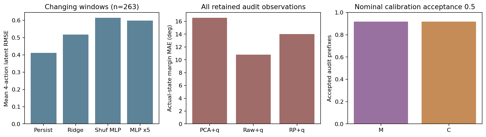
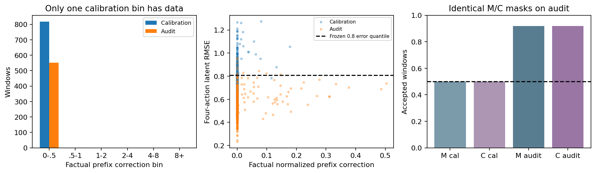
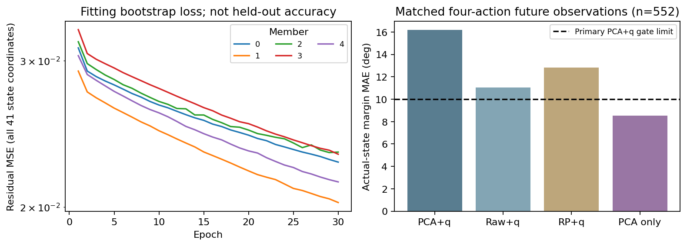
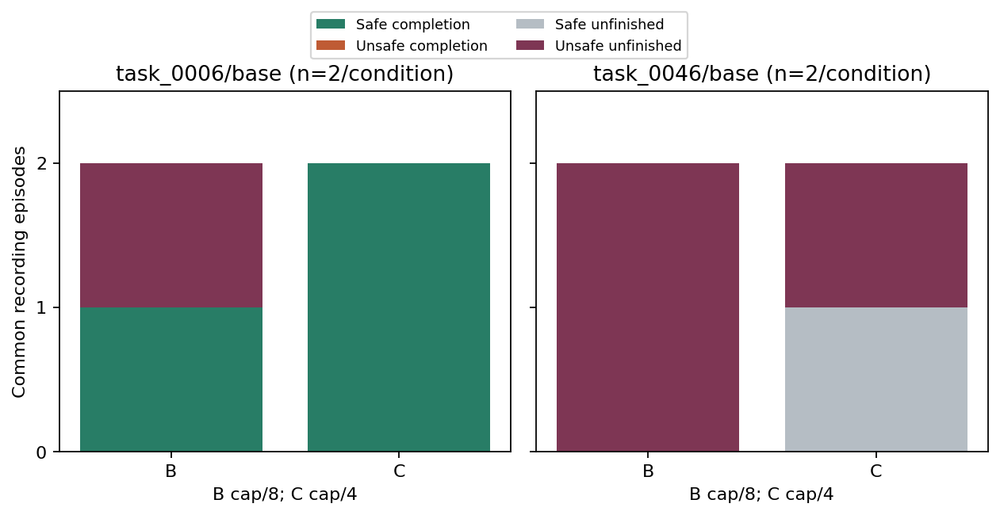

# ManiGuard Part 3: prediction feasibility and model-assisted evolution

The feasibility stage completed on 18 October 2026 and failed its frozen accuracy
gate. All seven event-support checks passed. The proposed 64-episode evolutionary
comparison is scientifically gated and unstarted, rather than unfinished because of
time or installation. No Part 3 evolved finalist, physical optimizer comparison,
lineage or search curve exists. Its implementation and prospective allocation remain
available, but imagined forecasts are not experimental fitness.

On 263 changing held-out windows, the five-network ensemble was 27.8% worse than
persistence after one action and 45.1% worse after four. The correct-action ensemble
beat the same ensemble with shuffled action prefixes by 2.69%, but remained 15.45%
worse than the fitted ridge reference. Thus there is some measured action dependence,
without the accuracy required to allocate physical search using these predictions.

| Frozen forecast check | Measured | Required | Result |
| --- | ---: | ---: | --- |
| One-action improvement over persistence | -27.78% | at least 5% | fail |
| Four-action improvement over persistence | -45.13% | at least 5% | fail |
| Four-action improvement over shuffled-prefix ensemble | 2.69% | at least 2% | pass |
| Four-action ensemble/ridge error | 1.155 | at most 1.05 | fail |
| Actual future-state PCA/robot margin MAE | 16.17 degrees | at most 10 degrees | fail |
| Forecast near-boundary margin MAE | 18.56 degrees | at most 10 degrees | fail |
| Forecast progress MAE | 79.01 mm | at most 30 mm | fail |
| Progress ranking Spearman correlation | .126 | at least .25 | fail |
| False reassurance on negative-margin windows | 0/99 | at most .10 | pass |
| Actual audit acceptance, M and C | 507/552 each | at least .10 | pass |
| Screening sixteen motion candidates | .810 s | at most 30 s | pass |

Mean per-window four-action latent RMSE on changing windows was .4120 for persistence,
.5179 for ridge, .5214 for action-shuffled fitted ridge, .6145 for the shuffled-prefix
ensemble and .5979 for the correct-prefix ensemble. The one-action ensemble/persistence
errors were .2962/.2318. These are errors in standardized latent coordinates, not
physical safety probabilities. The 552 audit windows belong to four episodes on one
held-out task, including 101 near-boundary and 99 negative-margin windows. All 99
negative-margin windows come from one episode and are correlated; 0/99 false reassurance
therefore supplies no independent-episode safety guarantee. There were 152 varying
progress windows. Near-boundary support occurred in 4/4 calibration and 2/4 audit
episodes, with one audit episode crossing the uprightness boundary.



The correction-dependent method also collapsed to the disagreement reference. All 818
calibration prefixes fell in the first correction bin, below .5; their largest
correction was .17839. Every other bin used the declared unconditional fallback.
Consequently all six error quantiles were the same (.80913). The C score was a positive
affine transform of M's disagreement, with common support and corresponding median
thresholds. Their audit acceptance masks were exactly equal: 507/552, or 91.85%, versus
50% on calibration. Audit correction bins contained 551/1/0/0/0/0 windows. The one-bin
calibration and changed acceptance show why nominal 50% acceptance is not a calibrated
safety interpretation or evidence of a distinct correction-aware method.



A post hoc diagnostic evaluates the already frozen readouts on the same 552 actual
future observations, without refitting or changing the gate. Margin MAE is 16.17 degrees
for PCA plus robot joints/fingers, 11.03 for raw pooled features plus robot state, 12.82
for a random projection plus robot state, and 8.54 for the visual-only PCA head. Their
progress MAEs are 80.57/52.94/104.53/41.13 mm. Thus the combined readout is already
inaccurate on real future states, before dynamics prediction is introduced. The
visual-only contrast cautions against attributing the entire failure to PCA losing
uprightness information. It suggests adverse cross-task covariate conditioning as a
hypothesis, not a proven cause or a replacement model accepted after seeing audit data.
The primary readout comparison on every retained audit observation remains separately
reported with its original denominator. PCA retains 82.05% of fitting visual variance;
variance retained does not certify safety-relevant information.



Sixteen Part 2 episodes on tasks 0039/0010 supply fitting data, charged once. The
predeclared eight common recordings were sealed before fitting: B/C on task 0046 with
seeds 5000/5001 for calibration, and task 0006 with 5010/5011 for the forecast audit.
Whole tasks, seeds and trajectories remain separate. Part 1's later exact RGB and
numerical margins are unavailable, so no Part 1 trajectory enters this model corpus;
its exposed comparison episodes are excluded. Final comparison tasks 0048/0050 and the
main-study test partition remain unopened. All eight new full recordings pass physical
trace, source/checkpoint, policy-seed and numerical/native uprightness checks.

The recording batch has 3/8 safe completions, 4/8 raw violations and 5/8 unfinished
records; none completes unsafely. Calibration has 0/4 completions and 3/4 violations;
audit has 3/4 safe completions and 1/4 violation. These common data outcomes are not
results of evolutionary selection. They cost 7,467 controls, 1,385 VLA queries, 45,490
post-subscription physics ticks and 1,216.82 seconds of outer episode-process time.
No extra episode, rescue sampling, full-episode retry or threshold adjustment follows
the failed gate. The native 1,100-action horizon and early success rules are preserved.



The frozen encoder is `facebook/dinov2-small` at revision
`ed25f3a31f01632728cabb09d1542f84ab7b0056`. Two 2-by-2 spatial pools produce 3,072 features.
Fitting-only standardization/PCA keeps 32 visual coordinates; seven arm joints and two
fingers remain outside PCA. Five episode-bootstrap residual MLPs, with two 128-unit
hidden layers, use current/previous state and previous/current executed environment
inputs. The final raw observation is preserved but excluded from model pairs because
it has no subsequent two-finger proposal frame. The first transition lacks causal
history and is also excluded. Dynamics never trains on proposed actions or privileged
monitor/goal labels. Numerical uprightness/progress targets train evaluation readouts,
not dynamics inputs. A tilt readout is not the complete spill/drop/uprightness monitor.
The known four-action prefix is the full screening horizon; future VLA chunks are
never invented. Source-freeze refinements precede scientific fitting and retain their
original receipts; numerical criteria, cases and physical budgets remain unchanged.

Scientific feature extraction encodes 37,314 images in 594 batches in 127.03 seconds.
Training uses 11,158 transitions, 6,600 optimizer steps and 1,668,720 member examples
across thirty epochs per member, taking 16.40 seconds. Torch peak allocations are
539,671,040 bytes for extraction and 80,667,136 bytes for training; concurrent process
memory is accounted separately. Calibration/audit/screening total 380 member calls
and 48,680 member examples. Frozen-source accounting also derives eight linear
dynamics reference calls over 4,416 examples and 39 readout matrix calls over
22,161 examples. CPU engineering is explicitly synthetic: 720 member calls,
22,440 examples, 1,520 training examples and ten optimizer steps, plus a two-image
encoder check. These checks are not measured prediction accuracy. The post hoc matched
readout diagnostic adds four matrix calls over 2,208 examples, with no new encoder,
dynamics, VLA or simulator call. Initialization physics before subscriptions remains
unknown. Continuous allocated GPU-hours include all CPU reporting and idle rental.

The full 3.34 GB raw-evidence archive is private, downloaded and SHA256 verified at
revision `a971f56192cddf540bf781865fc944b330006d9b` of the approved dataset
`Sachioster/safety-dial-phase3-part1-20261018`. It includes raw RGB, features, traces,
logs, videos and source/protocol snapshots, excluding keys, assets and checkpoints.
The own trained artifacts are separately private in
`Sachioster/maniguard-phase3-part3-20261018` at
`e769694671463f8ac2721e45e43491b0ce621373`, with every file download/hash verified.
The scientific GPU workers are stopped and their exit verified; rental-stop verification
follows final paper/report preservation.

The [shared GECCO paper](maniguard-phase3-part1-gecco/named.pdf),
[complete gallery](maniguard-phase3-part1-gecco/followup-videos.md),
[forecast audit](../research_notes/ManiGuard%20phase3%20Part3%20forecast%20audit.json),
[model diagnostics](../research_notes/ManiGuard%20phase3%20Part3%20model%20diagnostics.json),
[frozen data decision](../../../configs/maniguard/followup/part3-data-decision.json),
[source freeze](../../../configs/maniguard/followup/part3-model-source-freeze.json) and
[trained-artifact export](../../../configs/maniguard/followup/part3-frozen-model-export.json)
retain the protocol and evidence. Run the offline diagnostic with the explicit CPU
interpreter; do not restart the completed physical study:

```bash
uv run --no-project --python data/maniguard/envs/cpu/bin/python python \
  scripts/maniguard/followup_model_diagnostics.py
```

The next useful changes are prospective: establish saved-input repeatability; ensure a
feedback threshold actually activates on designated development data; improve prediction
and readouts against simple references across whole tasks; and require multiple supported
correction strata before treating C as distinct from M. The visual-only contrast motivates
readout regularization and information ablations. None is tested as a fix here. A later
model-assisted evolutionary comparison still needs matched physical budgets and real
fitness, and ordinary task-policy learning remains necessary for the broader claim.
