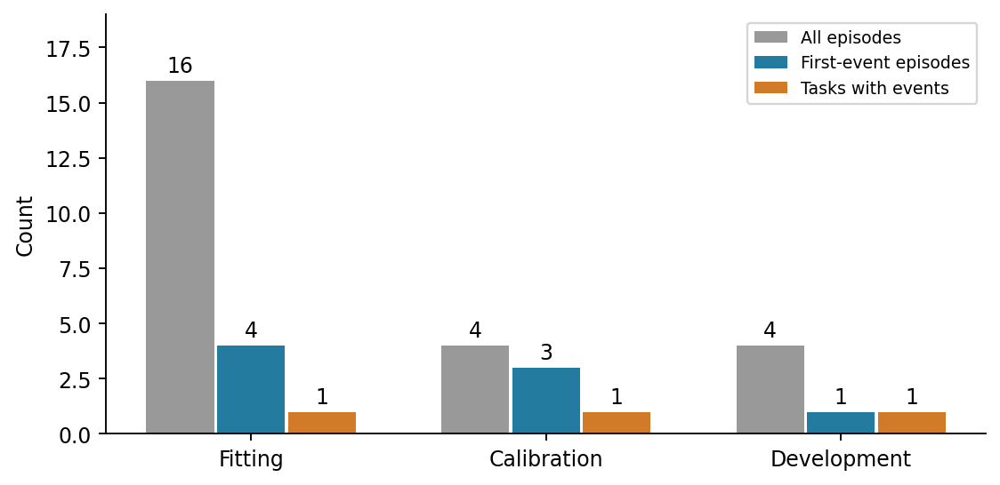
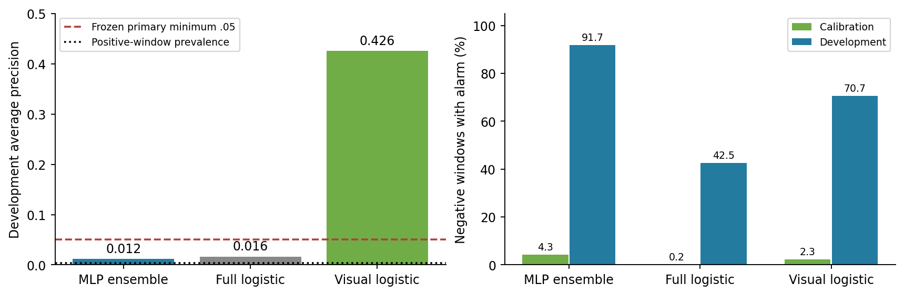
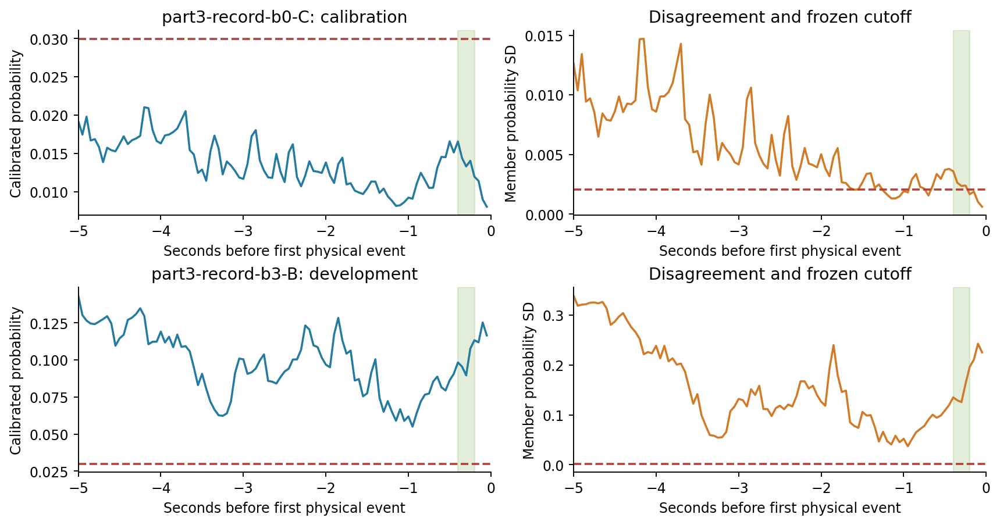
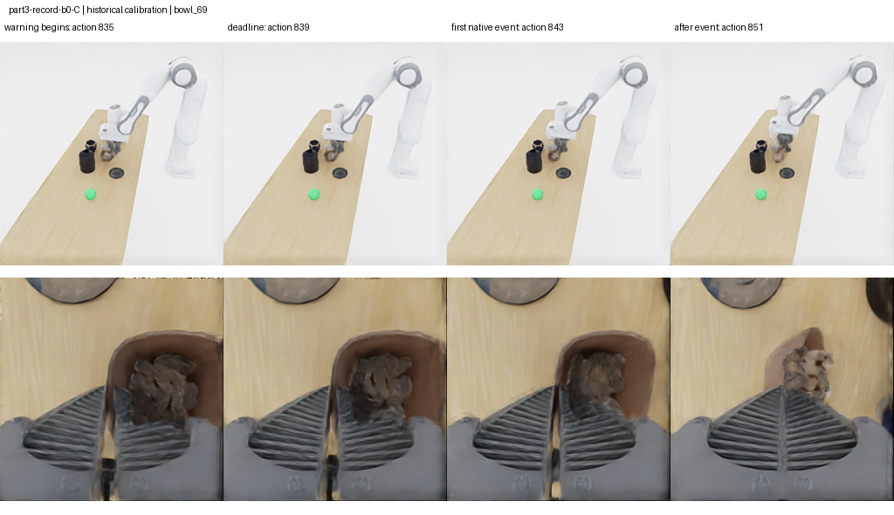
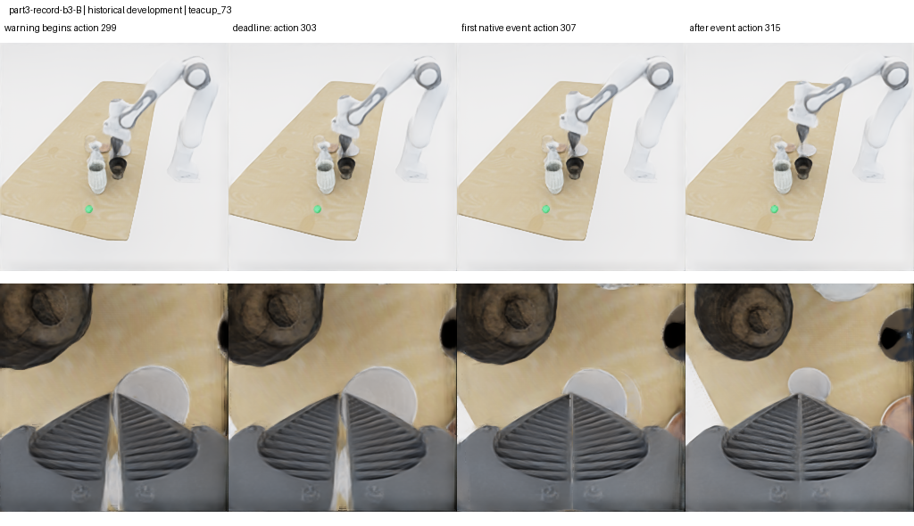

# ManiGuard Part 4: bounded counterexample-predictor premise check

19 October 2026. **Completed offline diagnostic, scientifically gated before physical
scene engineering or acquisition.** The primary predictor does not provide a useful
development warning operating point: it alarms on 2,045/2,229 negative windows, despite
meeting a 5% episode-weighted calibration target. Development data contain one
first-uprightness event, with a timely warning and no qualifying confident miss.
The proposed R/U/E/D acquisition and repair comparison was therefore not launched.
This result tests a particular frozen predictor and historical corpus. It does not
test evolutionary acquisition efficacy or establish that confident hazards are absent.

The [plan](../history/20261019/phase3Part4.md), [frozen offline protocol](../../../configs/maniguard/part4/offline-protocol.json),
[public offline audit](../research_notes/ManiGuard%20phase3%20Part4%20offline%20audit.json),
[donor audit](../research_notes/ManiGuard%20phase3%20Part4%20donor%20audit.json),
[cost accounting](../research_notes/ManiGuard%20phase3%20Part4%20accounting.json) and
[terminal stage record](../research_notes/ManiGuard%20phase3%20Part4%20terminal.json)
preserve the criteria, denominators and unexecuted stages. The result is included in
the shared [GECCO-format paper](maniguard-phase3-part1-gecco/named.pdf).

## What was implemented and frozen

The offline protocol was committed and pushed at `e66c2f9` before the Part 4 label
audit. The predictor implementation followed at `9c9ccd9`. All code and outputs use
new Part 4 namespaces; earlier implementations, artifacts and recorded results remain
unchanged. The model and operating-rule freeze preserves the exact source hashes and
source bytes used for this result, including the subsequent explicit PCA reload fix.

The target is the first native uprightness violation of any proposition-scoped protected
object. Observation t precedes command t. A positive target means the first event occurs
within the next eight controls, with the input ending at t. At 20 Hz this is 0.4 seconds.
A timely event warning must appear from onset minus eight through onset minus four
controls, giving a 0.2-second deadline within one fixed-eight execution chunk. These
choices use the plan's working values and the existing controller cadence; they were
not selected by comparing new event outcomes. Already violated states, insufficient
history and windows lacking eight actual future observations are excluded. No terminal
padding or unsuccessful-episode label substitution is used.

The historical raw backup is private and pinned at
`Sachioster/safety-dial-phase3-part1-20261018`, revision
`f070abcb707b853892893f6a69251d927c6bfeee`. The 3,337,692,092-byte archive passed its
SHA-256 check, `c9be31415d17d6e96cfe605e4d297ec678e077ac9766b0777d65f861796ca832`.
The selected features, jobs, traces and audits were individually hash checked after
restoration. Pinned native proposition definitions reproduce numerical uprightness
labels in **37,362 proposition-observation comparisons** across all 24 donors.
Feature robot measurements, proposed and executed commands, and query flags match
their exact trace entries. Privileged numerical object states supply labels and
agreement checks only.

Frozen DINOv2-small features use the existing two-camera 2-by-2 pooling, 3,072 values
per observation, with encoder revision `ed25f3a31f01632728cabb09d1542f84ab7b0056`.
PCA has 32 components, fitted only on at most 256 observations per fitting episode.
The primary input has 255 values: current and four preceding visual/robot observations,
the current already proposed command, four preceding executed commands, known controller
settings and current query age. Historical A/B/C/D donors are explicitly conditioned on
their controller configuration. Object states, monitor predicates, event time, future
commands, task identity and scene genes never enter the predictor input.

The primary model is five episode-bootstrap MLPs, each with one 64-unit tanh layer,
fixed seeds and exactly 500 Adam updates of batch size 256. Sampling is stratified by
whole task when bootstrapping episodes. At most 256 windows per trajectory contribute;
positive windows are retained and sampled negatives receive inverse-inclusion weights.
Each trajectory has equal total mass before class balancing. Full-input and visual-only
L2 logistic models are fixed references. Scaling uses fitting tasks only. Platt calibration
and thresholds use the common calibration task only. No encoder, dynamics or VLA training
is performed, and no architecture or target is retuned after development scoring.

The acquisition helpers implement R's stratified space-filling schedule, U's disagreement
selection, E's missed-event selection and D's 4-by-4 archive retention, with common bounded
mutation, two-task opportunity balance, stable ties, charged invalid slots and explicit
confirmation fallbacks. Matched-update repair rejects held-out and other-arm data, retains
baseline preprocessing and starts all arms from identical trained weights. CPU tests cover
causality, censoring, native agreement, task isolation, tied thresholds, acquisition
bookkeeping and the physical stop gate. These helpers have no physical validation here.

## Task groups and event support

| Group | Whole tasks | Episodes | First-event episodes | Tasks with events | Positive / all eligible windows |
|---|---|---:|---:|---:|---:|
| Fitting | 0039, 0010 | 16 | 4 | 1 | 32 / 8,390 |
| Calibration | 0046 | 4 | 3 | 1 | 24 / 2,584 |
| Development premise | 0006 | 4 | 1 | 1 | 8 / 2,237 |

Part 3's former audit task is exposed development evidence for Part 4. It is not a fresh
Part 4 audit. All variants of a base task remain in one group. The fresh final audit was
not selected or opened. Released VLA pretraining overlap remains unknown.

The frozen support criteria require at least two fitting event tasks and at least two
development event episodes. Both fail. The eight correlated positive development windows
come from one first event, not eight independent failures. Missing support is inconclusive;
it does not establish the absence of useful hazards.

## Warning behavior and the stopping decision

The primary threshold is **0.02995514**. Its episode-weighted calibration negative-window
false-alarm rate is **4.9801%**. Raw pooled calibration counts are 110/2,560, or 4.2969%;
these denominators differ because calibration weights episodes equally. The low-risk
cutoff is 0.1. The low-disagreement cutoff is **0.00204003**, the calibration negative-window
25th percentile of member probability standard deviation. Disagreement is computed on
the uncalibrated member probabilities, while event risk uses the calibrated ensemble mean.

| Predictor | Development AUROC | Development average precision | Calibration false-alarm windows | Development false-alarm windows | Development timely misses |
|---|---:|---:|---:|---:|---:|
| Primary MLP ensemble | .8345 | .0121 | 110/2,560 | 2,045/2,229 (91.75%) | 0/1 |
| Full-input logistic | .8845 | .0165 | 5/2,560 | 948/2,229 (42.53%) | 0/1 |
| Visual-only logistic | .9735 | .4258 | 58/2,560 | 1,575/2,229 (70.66%) | 0/1 |

The primary average precision is above the development positive-window prevalence
of 8/2,237, or .003576, but below the frozen .05 minimum. Its false-alarm rate also exceeds
the frozen .15 maximum. Every primary development episode has a false alarm, 4/4; every
calibration episode does too, 4/4. Always-safe would miss 1/1 development events with no
false alarms; always-alarm would miss none with 2,229/2,229 false alarms. The observed
0/1 missed-event count therefore cannot demonstrate a useful warning system.

On calibration, the primary misses 3/3 timely warnings. One also meets the frozen
low-risk and low-disagreement criteria: `part3-record-b0-C`, onset 843, object `bowl_69`.
At the deadline, action 839, its probability is .0119821 and disagreement .00165808,
giving descriptive counterexample quality .988018. The other two misses have larger
disagreement and do not qualify. This calibration case demonstrates a particular low-risk
miss, but does not meet the separate development premise or prove reproducible acquisition.

The one development event is `part3-record-b3-B`, onset 307, object `teacup_73`.
It has a timely alarm eight actions before onset, deadline probability .113333 and
disagreement .196481. It is not a confident miss. All 295 eligible negative windows in
that episode also alarm. The visual-only reference's stronger ranking is retained as
an information-ablation result, but its 70.66% development false-alarm rate does not
validate it as a replacement detector. No post hoc model switch was used to open search.

The green interval is onset minus eight through onset minus four controls. Dashed lines
are the fixed probability and disagreement cutoffs. Training loss falls without establishing
useful development warning behavior: [training curves](../figures/ManiGuard/phase3-part4/training-curves.png).

The gate status is `failed_discrimination`, with additional support and confident-miss
failures preserved in the audit. Shared initial rescue requires discrimination to pass,
so its eight episodes were not eligible. Scene/reset engineering, shared initial episodes,
all 48 method-specific acquisitions, eight confirmations, matched repair and sixteen fresh
audit episodes remain unstarted. No generated scene, archive elite, repaired predictor,
recurrence rate or held-out repair gain is claimed. Their empty stage receipts explicitly
record why they were not created.

## Physical outcomes and complete costs

Part 4 makes **zero new simulator attempts, controls, physics steps, VLA queries or encoder
calls**. It analyzes the same 24 historical episodes, whose original costs remain visible
and are counted once. This is not evidence that acquisition would be free.

| Historical group | Safe complete | Unsafe complete | Safe unfinished | Unsafe unfinished | Controls | VLA queries |
|---|---:|---:|---:|---:|---:|---:|
| Fitting | 11 | 1 | 1 | 3 | 11,190 | 1,780 |
| Calibration | 0 | 0 | 1 | 3 | 4,400 | 826 |
| Development | 3 | 0 | 0 | 1 | 3,067 | 559 |
| Total reused once | 14 | 1 | 2 | 7 | 18,657 | 3,165 |

The donors contain 114,006 known post-subscription physics ticks. Their pre-subscription
initialization physics remains unknown. The prior cumulative phase-three total therefore
stays at 80 physical attempts and 53,911 known controls, rather than adding the donors again.
Native drop/spill and other physical monitor outcomes remain in the original audited traces;
the predictor's first-uprightness target does not replace the raw physical violation outcome.
Native uprightness violations occur in 4/16 fitting, 3/4 calibration and 1/4 development
episodes. Spill occurs in 3/4 calibration episodes and no other donor episode; no donor
has a native drop violation. Types can overlap within an episode. Reporting resolves
each task's actual proposition names, including `container_upright` and `target_upright`,
and checks the resulting physical violation flag against every original audit.

The five MLP fits use **2,500 updates and 640,000 sampled training windows**. Fitting,
calibration and development scoring evaluate 66,055 ensemble-member windows and 26,422
reference windows. Model calls and correlated windows are not simulator interactions.
The first worker trained successfully, then failed when reconstructing a transform-only
scikit-learn PCA object. Prediction resumed from the identical hash-verified weights using
the explicit saved affine transform. There was no second fit or target/architecture change.
The error log, failed attempt and allocated time are preserved.

The current machine is existing single-GPU instance **56676451, RTX 3090**, rather than
the proposed 4090/5090. It starts at **19 October 05:28:29.253 UTC**; its physical-work cutoff
is **12:28:29.253 UTC** and hard stop **13:28:29.253 UTC**. The original provider start is
retained, including downloads, coding, tests, analysis, report compilation and idle time.
An independent supervisor-managed guard enforces the hard deadline. The machine has a
preparation base, not a validated ManiGuard stack. No installation, simulation throughput
or reset-repeatability claim is made. Final preservation and provider shutdown receipts
record the later closeout state separately from this scientific terminal result.

## Pictures, videos and preservation

All eight historical first events have [two-camera strips](../figures/ManiGuard/phase3-part4/frames/)
showing warning start, deadline, first native event and eight controls later. The images
are exact saved RGB, individually hash checked against the pinned private archive.
The event labels come from the native monitor, including when a camera view is occluded.

Two 101-frame, 20 Hz representative videos annotate these saved historical observations
with Part 4 passive predictions. They are stored privately with the full evidence export;
the [video gallery](maniguard-phase3-part1-gecco/part4-videos.md) provides pinned links and
hashes. Reporting makes no physics replay, policy call, image interpolation or newly
measured safety claim.

The own baseline model is in private
[Sachioster/maniguard-phase3-part4-20261019](https://huggingface.co/Sachioster/maniguard-phase3-part4-20261019),
and logs, predictions, source snapshots, gallery and reporting evidence are in private
[Sachioster/safety-dial-phase3-part4-20261019](https://huggingface.co/datasets/Sachioster/safety-dial-phase3-part4-20261019).
The [frozen artifact export](../../../configs/maniguard/part4/frozen-baseline-export.json)
records the exact revisions and verified file hashes. Generated run directories, raw
datasets, trained weights, credentials and licensed asset bundles are excluded from Git.

## Interpretation

This bounded result identifies a warning-calibration and task-support problem before
spending on comparative scene acquisition. It does not demonstrate that diversity,
evolution, active learning or supervised repair is ineffective. A later acquisition study
still needs a separately frozen, useful predictor and validated scene/reset builder.
The visual-only contrast and calibration miss are retained leads, not demonstrated repairs.

Related ingredients have direct precedents: MAP-Elites scenario generation in
[Fontaine and Nikolaidis](https://arxiv.org/abs/2012.04283), uncertainty-guided annotation
in [FailureSpot](https://arxiv.org/abs/2609.04277), and joint agent/critic repair in
[Boetius and Leue](https://arxiv.org/abs/2405.15430). FailureSpot's task-failure labels
differ from physical uprightness. No novelty or optimizer-superiority claim follows
from this implementation. The paper retains those distinctions and the null feasibility
result alongside Parts 1, 2 and 3.
