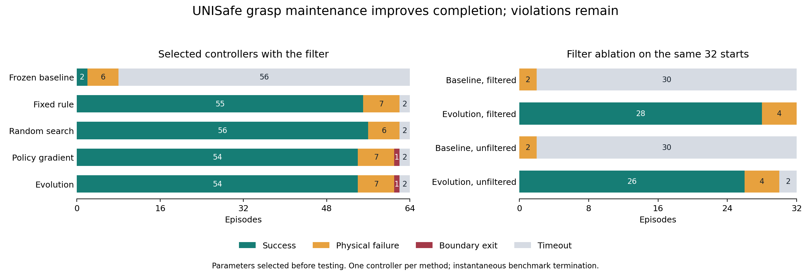

# UNISafe grasp maintenance and evolutionary adaptation

**16 October 2026. Completed simulator study on the migrated RTX 3090 stack.**

A small grasp-maintenance adapter substantially improves the released policy's task
completion under the unchanged UNISafe safety filter: the selected evolutionary controller
completes **54/64 reserved starts**, compared with **2/64** for the frozen baseline. A fixed
rule completes 55/64, random search 56/64 and categorical policy gradient 54/64. This supports
the behavioral correction, but does not demonstrate an evolutionary advantage. Physical
violations remain: evolution has seven physical failures and one boundary exit, compared
with six physical failures for the baseline.

The improvement largely persists without filtering. The evidence supports preventing a
basic loss of grasp; it does not yet establish a filter-specific continuation contribution.
This closes the initial objective of explaining one weakness and evaluating a response.
The broader research question in [oracle.md](../history/20261018/oracle.md) remains open.

[Compact evidence and accounting](assets/unisafe-grasp-maintenance-20261016/results.json),
[vector figure](assets/unisafe-grasp-maintenance-20261016/outcomes.svg),
[successful comparison video](../../../runs/unisafe/adaptation-evaluation-20261015/video-improvement/comparison.mp4),
and [failure comparison video](../../../runs/unisafe/adaptation-evaluation-20261015/video-failure/comparison.mp4).
The videos are local ignored artifacts, not included in git. Their hashes and selection
rules are preserved in the compact evidence.

## What caused the behavior in the original video

The [matched diagnosis](UNISafe%20release%20and%20switching%20diagnosis.md) shows the task
policy opening its gripper at 2.15 seconds, before the first safety replacement at 2.50
seconds. The yellow block then settles short of the extraction target and remains nearly
stationary. It is not repeatedly falling off the table. The filter's 0/1 display indicates
whether a backup arm command is applied, not whether a physical failure has occurred.
Switching makes subsequent commands more abrupt, but suppressing replacements alone does
not complete the episode.

A hand-timed hold prevents that loss of grasp and completes the original case at 2.80
seconds. The automatic adapter reproduces the same successful trajectory without an
episode-time trigger. It uses stable intermediate finger aperture and recent closing
commands to recognize a possible grasp, then delays a requested release for a bounded
number of control steps. It changes only the gripper proposal, before the filter evaluates
it. It does not use object geometry or outcome labels as controller inputs.

Finger position is additional information for this adapter relative to the pretrained
encoder. All four adaptation comparisons share that signal and controller family. The
baseline comparison therefore measures the complete behavioral and information change;
it cannot attribute the gain solely to optimization. The learned actor's reason for
opening early remains unresolved. The specification discrepancy and offline learned-head
checks are documented in the [development log](../research_notes/UNISafe%20adaptation%20development.md).

## Evaluation design

The [frozen protocol](../../../configs/unisafe/adaptation-replicated.json) separates inspected
development starts 0–19, training starts 20–23, validation starts 100–107 and test starts
1000–1063. These test starts were unused in this adaptation study; their overlap with the
original checkpoint's training data is unknown. Stress starts 2000–2031 remain unused.

Evolution, uniform random search and episodic categorical REINFORCE each evaluate 192
training episodes: three search seeds, four generations, four candidates and four starts.
They share the parameter domain and initial populations. Elite reevaluations and discarded
candidates count. Policy gradient learns a distribution over the same three adapter
parameters; it does not fine-tune Dreamer or the pretrained weights. Equal episode caps
produce different realized control-step costs.

Validation evaluates nine finalists per optimizer, three fixed-delay choices and the
baseline on eight starts each, giving 248 episodes. Within each method, the declared rule
prefers candidates with no more observed violations than baseline, then maximizes terminal
utility, with a deterministic parameter tie-break. That small selection-set screen is not
a population safety guarantee. It selects these controllers before any test outcome:

| Controller | Maximum hold | Minimum closing steps | Minimum aperture per finger |
| --- | ---: | ---: | ---: |
| Frozen baseline | 0 steps | 3 | 5 mm |
| Fixed rule | 40 steps, 2.00 s | 3 | 5 mm |
| Random search | 60 steps, 3.00 s | 1 | 5 mm |
| Policy gradient | 15 steps, 0.75 s | 3 | 6 mm |
| Evolution | 15 steps, 0.75 s | 3 | 5 mm |

The maximum aperture is 25 mm per finger and the permitted change is less than 2 mm between
observations. A delay event can end at episode termination. Parameters, runtime code and
analysis hashes were frozen at commit `b45e72052cc3dd10ddb98ee27e107d355fd709d5`.

All 384 test episodes use a fresh simulator process, with randomized job order and one
worker. Five filtered controllers receive 64 starts each; baseline and evolution also
receive 32 unfiltered starts each. The unfiltered controls retain shadow model queries
and their random-draw schedule. All 320 declared comparisons pass the observed-prefix
audit: initial physical state, camera inputs and preceding actions agree through the first
action change, which has the declared adapter or filter-mode cause. This establishes the
recorded matching, not equality of every unobserved simulator state.

The task retains its released compound success predicate, including greater than 7 cm
middle/base XY separation. Physical failure includes middle or top height below 13 cm,
or top/base XY distance above 10 cm. End-effector XY boundary exits are reported separately.
The horizon is 300 control steps at 20 Hz. Success is evaluated at benchmark termination;
there is no additional post-termination stability simulation.

## Reserved results with the filter enabled

| Selected controller | Successes / 64 | Physical failures | Boundary exits | Timeouts | Control steps |
| --- | ---: | ---: | ---: | ---: | ---: |
| Frozen baseline | 2 | 6 | 0 | 56 | 17,286 |
| Fixed rule | 55 | 7 | 0 | 2 | 4,631 |
| Random search | 56 | 6 | 0 | 2 | 4,697 |
| Policy gradient | 54 | 7 | 1 | 2 | 4,482 |
| Evolution | 54 | 7 | 1 | 2 | 4,482 |

Evolution's success rate is 84.4%, compared with 3.1% for baseline. There are 52 starts
where only evolution succeeds and none where only baseline succeeds. The paired difference
is **81.25 percentage points**, with a conservative exact 95% interval of **61.22 to 90.85
points**. The exact two-sided McNemar p-value is 4.44e-16, or 1.78e-15 after Holm adjustment
across the four declared success comparisons.

| Evolution compared with | Success difference in percentage points | Conservative exact 95% interval | Holm-adjusted p |
| --- | ---: | ---: | ---: |
| Frozen baseline | +81.25 | +61.22 to +90.85 | 1.78e-15 |
| Fixed rule | -1.56 | -12.08 to +9.30 | 1.00 |
| Random search | -3.13 | -12.10 to +6.35 | 1.00 |
| Policy gradient | 0.00 | -6.62 to +6.62 | 1.00 |

The intervals combine exact 97.5% binomial intervals for paired win and loss probabilities,
using Bonferroni to obtain at least 95% coverage for each difference. They are conservative
and are not simultaneous intervals across all four comparisons. Inference concerns the
sampled initial-condition distribution on this simulator stack.

Evolution and policy gradient have identical success, physical-failure and any-violation
indicators on every test start. That does not establish identical trajectories or equivalence
in a broader population. These results compare one validation-selected controller per
method, rather than the expected performance of an optimizer across training replicas.
There is no evidence here for paying the additional complexity of evolution over a fixed
rule, nor for ranking these small differences as reliable optimizer effects.

Safety has not been established as unchanged. Evolution violates on 8/64 starts and baseline
on 6/64; their violating starts are disjoint. The paired any-violation difference is +3.13
percentage points, with a conservative exact 95% interval of -15.92 to +21.74 points.
The data cannot support a safety non-inferiority claim. Keeping the filter fixed does not
keep the visited states or physical risks fixed.

## Does the improvement depend on filtering

The four cells below use the same first 32 test starts. They are a subset of the main
filtered comparison plus the additional unfiltered episodes, not four independent studies.

| Controller and mode | Successes / 32 | Physical failures | Boundary exits | Timeouts |
| --- | ---: | ---: | ---: | ---: |
| Baseline, filtered | 0 | 2 | 0 | 30 |
| Evolution, filtered | 28 | 4 | 0 | 0 |
| Baseline, unfiltered | 0 | 2 | 0 | 30 |
| Evolution, unfiltered | 26 | 4 | 0 | 2 |

The adaptation gain is 87.5 percentage points with filtering and 81.25 without it.
Their difference is 6.25 points; the paired bootstrap's descriptive 95% interval is
0 to 15.63 points. Boundary counts and this small exploratory subset limit that interval's
interpretation. Most of the benefit survives removal of safety replacements. The supported
interpretation is grasp maintenance, with no established filter-specific interaction effect.

## What the videos and remaining failures show

The improvement video uses seed 1000, the first numerical test seed where evolution succeeds
and baseline does not. Both recordings agree before the adapter first changes the gripper
at step 16. Evolution finishes at 1.20 seconds; baseline times out at 15 seconds. The failure
video uses seed 1006, the first numerical evolutionary violation. These selection rules were
declared before testing; the examples illustrate behavior, not outcome frequencies.

In seed 1006, the first gripper change is at step 17 and the filter intervenes at steps
19 and 20. The yellow middle block remains held, but the orange top block drops to 12.54 cm,
below the 13 cm failure threshold, at 1.05 seconds. Baseline times out without that failure.
The matched prefix supports attributing the changed trajectory to the adapter; the recording
does not isolate which later contact or backup action is responsible for the falling block.
Both videos explicitly label held terminal frames.

Across evolution's seven physical failures, five terminate on top-block height and two on
middle-block height. Its boundary case ends at end-effector x = 29.78 cm, outside the 30 cm
lower limit. One remaining timeout has 75 delay overrides but only 0.60 cm final middle/base
XY separation; the other has no override and ends at 2.75 cm. These retrospective trace
descriptions show limitations of the narrow release rule. They do not by themselves diagnose
filter-caused stalls or establish a recovery strategy.

## Interaction and compute accounting

All adaptation development and evaluation episodes, including warmups, engineering checks,
failed candidates and repeated evaluations, remain counted:

| Phase | Episodes | Control steps | Physics steps |
| --- | ---: | ---: | ---: |
| Identity acceptance | 3 | 900 | 4,500 |
| Command-history development | 32 | 7,484 | 37,420 |
| Grasp-aware acceptance | 3 | 656 | 3,280 |
| Grasp-aware development | 32 | 4,571 | 22,855 |
| Fresh-process acceptance | 2 | 351 | 1,755 |
| Initial development search | 144 | 16,828 | 84,140 |
| Replicated training | 576 | 68,912 | 344,560 |
| Selection validation | 248 | 19,956 | 99,780 |
| Reserved evaluation | 384 | 47,039 | 235,195 |
| **Adaptation-study total** | **1,424** | **166,697** | **833,485** |

Training uses 21,462 control steps for evolution, 23,839 for random search and 23,611 for
policy gradient. Across the physical adaptation study, encoder, task actor, uncertainty
ensemble, imagined dynamics and failure head each receive 166,697 calls; posterior, safety
actor and safety critic each receive 333,394. Ensemble calls count invocations, not individual
members. The separate offline release diagnostic adds zero simulator steps, 600 reward-head
and 600 continuation-head calls, plus its replay queries. Detailed component totals are
preserved in the evidence record.

The replicated search takes 7,119.66 seconds, validation 1,854.02 seconds and the reserved
batch 14,053.87 seconds. These are launcher elapsed times. Worker, launcher and handoff
waiting timers overlap and must not be added together; their individual records are retained.
The two deliberately stopped concurrent startup attempts contribute no physical steps or
model queries, but their startup time remains recorded. The replicated search has 36
selection/distribution updates, of which 12 are policy-gradient updates; the earlier search
has nine and three respectively. No pretrained weights change.

Earlier shared work is separate: the autonomous baseline adds 14,168 control steps, causal
probes add 4,099, and five instrumented environment checks add 300. Earlier migration attempts
have incomplete interaction or timing instrumentation, and original pretraining costs are
unknown. The adaptation subtotal is exact for the recorded study; it is not an exact
whole-project compute total.

## Provenance and research decision

The complete test artifact audit checks every recorded physical transition, action transform,
terminal classification, filter setting, model-query count and frozen implementation hash.
Training choices, evaluation order, fitness and optimizer state reconstruct exactly, and
validation selection passes its independent audit. All test jobs finish without retry.
A separate SciPy calculation agrees with the four paired contrasts' exact tests.

One training repeatability exception remains documented: seven unused model-output fields
differ in three steps of the shared initial population for search seed 2027, while recorded
physical states, images, actions and outcomes agree. The cause remains unresolved. Seeds
2028 and 2029 match all recorded non-timing fields. This qualification is retained rather
than claiming universal deterministic inference.

The environment uses Isaac Sim 6.2, pinned Isaac Lab 3 source, Python 3.12 and PyTorch
2.11 with CUDA 13 on an RTX 3090. Upstream UNISafe remains at
`ab0fdf87f38edefa48b54a291ec5b7156c17b6e0`; the private checkpoint mirror remains at
`39bd3c84a1c9f3e84891eb09b1122d252c84e9c9`. Filter snapshot 200000, uncertainty threshold
4.3, value threshold 0.1 and the released backup convention are unchanged. This is a
migrated-system study, not established reproduction of the historical training environment
or a real-robot safety result.

Retain the fixed grasp-aware rule as a strong comparator and the frozen baseline as the
reference. The next research decision should test whether a consequential difficulty remains
that depends on filtering and resists simple adaptation and ordinary learning. Investigate
the residual top-block failures before claiming a safety improvement. Expanding evolution
on this three-parameter problem has no demonstrated benefit. The alternate Hard task was
source-audited but has commented-out termination callbacks; it needs an explicit outcome
contract and migration acceptance before a valid comparison. No additional environment was
run merely to obtain an evolutionary win.

Reproduction commands and a frozen two-job demonstration plan are in the
[experiment guide](../../../experiments/README.md#unisafe-task-adapter-study). The demonstration
uses an already inspected test example and must not be counted as fresh generalization evidence.
