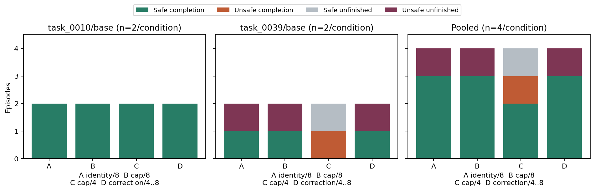
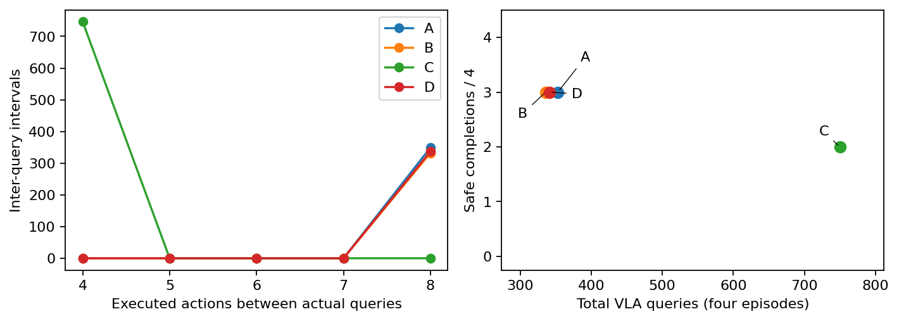
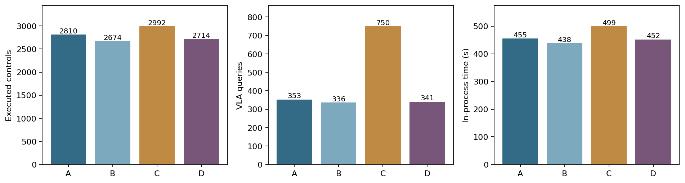

# ManiGuard Part 2: correction-triggered policy feedback

The frozen sixteen-episode comparison completed on 18 October 2026. Identity, fixed
interval eight and correction-triggered feedback each safely completed 3/4 episodes.
Fixed interval four safely completed 2/4. Every condition had one violating episode.
There is no observed adaptive-feedback benefit in this sample. The trigger never
changed the query schedule, so the benefit of an actively triggering rule is unresolved.

| Condition | Safe completion | Raw violation | Requested completion | Unfinished | Unsafe completion | Actions | VLA queries |
| --- | ---: | ---: | ---: | ---: | ---: | ---: | ---: |
| A: identity, interval 8 | 3/4 | 1/4 | 3/4 | 1/4 | 0/4 | 2,810 | 353 |
| B: caps, interval 8 | 3/4 | 1/4 | 3/4 | 1/4 | 0/4 | 2,674 | 336 |
| C: caps, interval 4 | 2/4 | 1/4 | 3/4 | 1/4 | 1/4 | 2,992 | 750 |
| D: caps, correction-triggered 4 to 8 | 3/4 | 1/4 | 3/4 | 1/4 | 0/4 | 2,714 | 341 |

All four conditions safely completed both `task_0010/base` episodes. On
`task_0039/base`, A/B/D each safely completed one episode and left one unfinished with
a violation. C had one unsafe completion and one safe unfinished episode. These are
two scene variants and four episodes per setting, with no inferential superiority claim.



The question was whether command correction identifies a useful time to refresh a
frozen VLA chunk. A queries every eight actions without changing commands. B/C/D share
the Part 1 finalist's .04/.02 rad caps, finger heuristic and smoothing one. C queries
every four actions. D sums the L2 departure between proposed and final environment-input
arm targets, divided by `sqrt(7) * .04 rad`; per-coordinate differences at most `1e-6`
rad are zeroed. It refreshes after at least four actions once the sum reaches .5, or
after eight actions regardless. The sum resets at a query. Native goal termination
takes precedence, and history uses inputs after action-space clipping. This signal is
command departure, not measured movement or physical risk. Monitor labels and object
states remain outside the controller. The native 1,100-action horizon is preserved.

All 337 observed intervals between D's queries were eight actions. Its threshold was
crossed once, at the eighth action, when the maximum interval already required a query;
there were zero crossings at actions four through seven. Its maximum accumulated
correction was .60146. The fixed-four condition used 750 queries versus B's 336, without
improving measured safe completion. This does not establish that frequent feedback is
harmful or that an independently calibrated active trigger would fail.

Substantial arm corrections above `1e-6` rad occurred on 0/76/55/54 actions for A/B/C/D.
Exact changed-command counters were 0/122/95/92; the difference is floating-point
roundoff from the cap mapping, rather than additional substantial interventions.
Every condition made contact in all four episodes. Grasp evidence occurred in 4/4
for A and 3/4 for B/C/D. Inactivity is therefore not a sufficient explanation of all
outcomes, but these episode flags do not establish successful continuation after contact.



The four matched blocks use `task_0039/base` seeds 4000/4001 and `task_0010/base` seeds
4010/4011, with condition orders ABCD, BCDA, CDAB, DABC. All twelve initial robot-state
comparisons against A were exactly equal. None of the 24 corresponding camera pairs or
twelve first policy chunks was exactly equal. Scene and sampling-seed matching therefore
does not support episode-level causal counterfactual claims. The main-study test
partition remains unopened. The prescribed Part 3 fixed-reference rule selects B:
mean utility .25 versus C's 0, with no new tuning or sampling.

Three 32-action engineering checks pass for A/C/D, totaling 96 controls, 20 queries
and 834 post-subscription physics ticks. One earlier attempt fails before simulator
startup because of an import-side-effect bug; missing native counters remain unknown.
Its approximately two-second process record and two earlier coordinator/tooling failures
are preserved. The repair and pre-application failure allowance precede the comparison
freeze; no full episode is retried. A protocol deviation is retained: synthetic CPU
checks preceded engineering, but replay of recorded physical inputs first audited those
engineering jobs, rather than preceding them as the plan requested. Every engineering
replay passed before the full comparison freeze. Targeted followup verification passes
24 CPU tests, including exact identity, causal clipped-input history, query scheduling,
partitioning, model accounting and independent process-tree cleanup.

The sixteen full episodes use 11,190 controls, 1,780 queries and 68,516 recorded physics
ticks. Outer episode-process time totals 1,897.69 seconds. In-process time totals
455.13/438.27/499.49/451.85 seconds for A/B/C/D; passive capture totals
49.72/46.69/52.20/47.83 seconds, respectively. These overlapping timings do not add
allocated GPU-hours. Pre-subscription initialization physics is unknown for every launch.
Failures, discarded work and shared data remain in the cumulative accounting.



Every existing observation was saved losslessly with both native cameras and robot
state, without additional rendering or physics. Evaluation-only float32 uprightness
margins reproduce the pinned local +Z convention and per-object tilt thresholds.
Target-to-goal distance is also saved. These targets are outside the live controller
and completion contract. Equal recording makes Part 3 possible; Part 2 did not depend
on training a model. Native videos cover both cameras in all sixteen full episodes.
Eight matched videos cover every block/camera, with black panels labelled ENDED after
an episode ends. Event pictures cover every violation before/at/after its first boundary;
nonviolating episodes have start/middle/final strips. No physics is replayed for reporting.

The [shared GECCO paper](maniguard-phase3-part1-gecco/named.pdf),
[followup gallery](maniguard-phase3-part1-gecco/followup-videos.md),
[audited records](../research_notes/ManiGuard%20phase3%20Part2%20audit.json),
[frozen controllers](../../../configs/maniguard/followup/part2-frozen-controller-export.json),
[protocol](../../../configs/maniguard/followup/part2-protocol.json) and
[schedule](../../../configs/maniguard/followup/part2-jobs-plan.json) retain the evidence.
The source/protocol milestone is commit `d6ec9f2`. Raw evidence is under
`runs/maniguard/phase3-parts2-3/20261018-56582094/part2` and in approved private backups,
excluding keys, asset bundles and checkpoints.

Reproduce the offline audit and exports with the explicit CPU interpreter:

```bash
uv run --no-project --python data/maniguard/envs/cpu/bin/python python \
  scripts/maniguard/followup_evidence.py all
uv run --no-project --python data/maniguard/envs/cpu/bin/python python \
  scripts/maniguard/followup_diagnostics.py
```

The allocation still starts at 18 October 16:00:37 UTC. The user extended the original
23:00:37/00:00:37 physical/hard limits to 19 October 03:00:37/04:00:37 UTC, preserving
setup, implementation, failed and idle rental time. An independent guard enforces the
physical target for policy, simulation and model workers. This extension changes the
rental limit, not the sixteen-episode allocation. Final rental accounting follows the
Part 3 terminal outcome and preservation.
